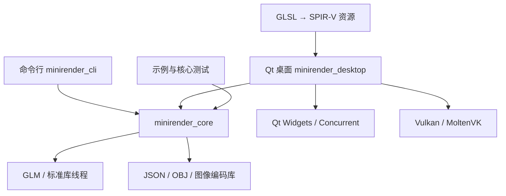

# MiniRender

MiniRender 是用于学习图形学的小型渲染引擎，使用 C++20、Qt Widgets 和 Vulkan，提供交互式场景编辑、实时预览及 CPU 离线渲染。几何处理、布料模拟和光场工具共用场景与资产系统，生成的模型可以继续编辑、保存和渲染。

## 功能

| 模块 | 支持内容 |
| --- | --- |
| 场景编辑 | OBJ 导入、JSON 场景保存、材质与纹理编辑、物体拾取和移动/旋转操纵器、撤销/重做；物体检查器与全局渲染设置独立停靠 |
| 实时预览 | 材质原色与纹理、轮廓和接触遮蔽；方向光与 PCF 阴影、GGX 材质、IBL、SSAO；HDR、曝光、FXAA，以及法线、深度、线框和 AO 视图 |
| 路径追踪 | SAH BVH、多线程采样、MIS、Russian roulette、薄透镜景深；漫反射、金属、镜面和玻璃；面积光、方向光及环境光 |
| 高级光照 | 均匀 RGB 介质与多次体积散射、SPPM 焦散、dipole BSSRDF 次表面散射 |
| 几何处理 | 半边拓扑、均匀与自适应 Loop 细分、高度位移、QEM 简化、各向同性重网格、OBJ 导出 |
| 点云与 SDF | PLY 导入/导出、网格表面采样、PCA 法线与定向、多半径 Ball Pivoting 重建；球、盒、圆环及 CSG 距离场编辑与渲染 |
| 布料 | 质量弹簧模拟、固定子步、风与球/平面碰撞、播放/暂停、状态保存与冻结网格；可编辑的微圆柱经纬材质 |
| 光场 | 二维瞳孔阵列采集、流式光场文件、子视图查看、交互式焦距与孔径调整；重聚焦复用已采集数据 |

离线任务支持实际采样进度、暂停、恢复、取消及 PNG/EXR 导出。工具栏“快速导入”提供 Cornell Box、材质球、雾与光束、玻璃焦散、蜡和大理石、光场棋盘等场景，导入后可继续编辑和另存。

### 资源目录

打开工具栏的“快速导入 → 资源目录”，按名称、类型或作业编号筛选资源。选择场景会覆盖当前文档，选择模型会把物体及其材质追加到当前场景，选择帧序列会打开独立播放器。整组模型可以一次撤销。另存场景时，目录导入的模型与纹理会随 JSON 保存到目标目录，可以一起复制到另一台电脑。

应用内置 16 个场景、一个可追加的单位立方体和四帧 EXR 示例。已准备好的课程包可通过“选择课程包…”挂载，应用会记住路径。Mary 和 Bunny 均提供独立场景与追加模型两种入口。HW5 的 box 与 pink-room 可按帧播放或拖动查看。

从已解压的作业生成课程索引时，准备 Python 3、FFmpeg 和本项目构建的 CLI。下例假定课程目录中已有 `frameworks/HW0`、`frameworks/HW2` 以及 `HW5-data/{box,pink-room}/input`。脚本生成索引后，在资源目录选择包含 `resource_catalog.json` 的文件夹。

```sh
python3 scripts/prepare_course_catalog.py work/GAMES202 --cli build/macos-desktop-release/minirender_cli
```

### 视口对照

在视口的显示下拉框选择 Blinn–Phong，可以观察教学点光源下的底色、纹理和高光。在相机面板调整点光源位置、强度和高光指数。Mary 展示场景在资源目录中提供对应的预览按钮。

相机面板中的“右侧对照”开启同视口 A/B 比较。两侧共用场景、相机和曝光设置，按各自的显示模式处理颜色。拖动中间竖线改变两侧宽度，其他位置仍然可以拖动相机。“导出 A/B 图像”将两个完整视图的 PNG 和显示变换前的线性光照 EXR 写入新文件夹。

### 方向光阴影

在资源目录选择“接触软阴影 → 覆盖并预览 PCSS”。两个挡板与地面的距离不同，离地较高的挡板投下较宽的半影。相机面板可选择硬阴影、固定半径的 PCF 或随遮挡距离变化的 PCSS，调整光源半角并观察变化。打开右侧对照后，两侧可分别选择阴影算法。“阴影深度”“遮挡物深度”“半影半径”和“光源可见性”显示当前诊断光源在可见表面上的值，半影半径以 64 纹素对应白色。

### 金属补偿

选择“白炉 · 粗糙金属 → 覆盖并预览能量补偿”，比较均匀白光下两排金属球的亮度。上排材质启用了 Kulla–Conty 多次散射补偿。对象检查器中的“补偿多次微面散射”同时控制 Vulkan 预览和 CPU 路径追踪。相机面板的“右侧金属”可以让同一个物体在分屏两侧使用不同模型。本地课程包另提供 HW4 球体与冬季 HDR 环境，可观察金、铜等有色反射。

`minirender_energy_example 输出目录 [分辨率] [每格样本数]` 分别使用均匀半球、GGX 可见法线和 split-sum 积分生成 EXR 表。红色通道为方向反照率，蓝色通道为该粗糙度的余弦加权平均。公式与采样方法见 [IBL 文档](docs/IBL.md)。

## 构建要求

- Git、CMake 3.25 或更新版本、Ninja，以及支持 C++20 的编译器。
- 桌面程序需要 Qt 6.8 或更新版本，以及 Vulkan SDK（含 `glslangValidator`）。macOS 通过 MoltenVK 使用 Vulkan。
- 安装脚本和 GPU 验证脚本使用 Python 3。

GLM、Catch2、JSON、OBJ 和图像解析依赖由 CMake 管理，缺失时下载固定版本并核对哈希。CPU-only 构建可独立使用，不需要 Qt、Vulkan 或 CUDA。依赖版本和配置说明见[构建文档](docs/BUILD.md)。

先获取源码，以下命令均在仓库根目录执行：

```sh
git clone https://github.com/aCannedFish/MiniRender.git
cd MiniRender
```

## macOS

安装 Xcode Command Line Tools，并通过 Homebrew 安装桌面依赖：

```sh
xcode-select --install
brew install cmake ninja qt glslang molten-vk vulkan-loader vulkan-headers vulkan-validationlayers vulkan-tools
```

构建并运行核心测试：

```sh
cmake --preset macos-desktop-release
cmake --build --preset macos-desktop-release --parallel 4
ctest --preset macos-desktop-release --output-on-failure
```

保存场景并退出正在运行的 MiniRender，然后安装：

```sh
python3 scripts/install_macos.py
open /Applications/MiniRender.app
```

安装器打包 Qt 和 Vulkan 运行库及内置场景，通过隐藏窗口检查后更新 `/Applications/MiniRender.app`，并清理同应用标识的旧安装包和工作树构建包。后续更新重复上述配置、构建和安装命令。

只使用 CPU 命令行时，选择 core preset：

```sh
cmake --preset macos-core-release
cmake --build --preset macos-core-release --parallel 4
ctest --preset macos-core-release --output-on-failure
```

## Windows

安装 Visual Studio 2022 的 C++ 工具链、CMake 和 Ninja，在 x64 Developer PowerShell 中构建 CPU 程序：

```powershell
cmake --preset windows-core-release
cmake --build --preset windows-core-release --parallel 4
ctest --preset windows-core-release --output-on-failure
.\build\windows-core-release\minirender_cli.exe --capabilities
```

构建桌面程序还需安装 Qt 的 MSVC 版本和 Vulkan SDK。将下面的 Qt 路径替换为本机目录：

```powershell
$qtPrefix = "C:/Qt/6.11.2/msvc2022_64"
$env:CMAKE_PREFIX_PATH = $qtPrefix
$env:PATH = "$qtPrefix/bin;$env:PATH"
cmake --preset windows-desktop-release
cmake --build --preset windows-desktop-release --parallel 4
.\build\windows-desktop-release\src\app\desktop\minirender_desktop.exe
```

桌面依赖配置见[构建文档](docs/BUILD.md#windows)，目标设备验证和安装包进度见 [PLAN.md](PLAN.md#nvidia-阶段)。

## 使用

### 桌面操作

1. 打开应用，在“快速导入”中选择场景。
2. 使用默认“原色预览”查看模型。单击选中物体，在视口按 V/T/R 切换选择、移动和旋转；右侧检查器调整材质与几何。
3. 在左侧“场景与渲染”面板调整相机和光源，或进入“离线”页选择 Path Tracing/SPPM，设置采样参数后点击“开始”。

视口上方可切换原色、光照和诊断视图。原色模式便于查看初始模型；光照合成显示实时方向光与环境光效果；面积光、间接照明、体积和次表面散射通过离线渲染查看。

窗口布局和控件见[编辑器界面](docs/EDITOR_UI.md)，模板说明见[内置场景](docs/BUILTIN_SCENES.md)，预览模式见[原色预览](docs/BASE_COLOR_PREVIEW.md)。

### 命令行

以 macOS core 构建为例，渲染 Cornell Box：

```sh
build/macos-core-release/minirender_cli --render scenes/cornell-box.json outputs/cornell --width 128 --height 128 --spp 32 --depth 10 --mode mis --seed 101 --threads 4
```

输出为 `outputs/cornell.exr` 和 `outputs/cornell.png`。Windows 使用 `build/windows-core-release/minirender_cli.exe`，参数相同。桌面构建目录中也包含 CLI。

CLI 还提供场景检查、法线图、光场采集与重聚焦命令，可通过 `--help` 查看入口。详细参数见[路径追踪](docs/PATH_TRACING.md)、[离线任务](docs/RENDER_SESSION.md)和[光场](docs/LIGHT_FIELD.md)。

### 开发调试

VS Code 打开仓库根目录，安装推荐扩展后选择 `macos-desktop-debug` 或 `windows-desktop-debug`，执行 CMake 配置。CMake Tools 与编译数据库为 Qt、Vulkan 和核心依赖提供语法检查参数，详见 [VS Code 配置](docs/VSCODE.md)。

GPU 回归默认使用隐藏窗口，例如验证原色预览轮廓：

```sh
python3 scripts/verify_gpu.py /Applications/MiniRender.app --scene scenes/studio.json --outline-check --sync-validation --output outputs/outline --timeout 240
```

## 文档

完整目录、文件职责和依赖关系见下方[架构](#架构)。

- [学习路线](docs/LEARNING.md)：从场景与像素开始阅读各模块实现。
- [场景格式](docs/SCENE.md)：模型、材质、纹理、相机与场景保存。
- [几何工具](docs/GEOMETRY_UI.md)、[点云工具](docs/POINT_CLOUD_UI.md)、[布料工具](docs/CLOTH_UI.md)：编辑、处理与导出资产。
- [离线界面](docs/OFFLINE_UI.md)、[光场界面](docs/LIGHT_FIELD_UI.md)：渲染任务、文件与图像输出。
- [PLAN.md](PLAN.md)：开发计划、阶段状态及验证记录索引。

## 架构

导航：[公开接口](#公开接口) · [核心实现](#核心实现) · [桌面程序](#桌面程序) · [着色器](#着色器) · [场景](#内置场景) · [示例](#示例程序) · [测试](#核心测试) · [构建与工具](#辅助脚本) · [阅读顺序](#阅读顺序)

### 总览

工程由共用的 CPU 核心库、CLI 和桌面应用组成。`include/minirender` 是公开接口，`src` 中的同名模块实现这些接口；放在 `src` 内的头文件供模块内部协作使用。数据通过场景文档、不可变快照和任务结果在模块之间传递。



箭头表示调用或链接关系，着色器箭头表示资源输入。`core`、`scene`、`geometry`、`render`、`simulation` 和 `assets` 是 `minirender_core` 内的源码模块。它们共享类型，例如布料组件引用场景变换，光场文件保存渲染标定。

一次典型操作按以下路径执行：

1. `assets` 读取文件，构建 `SceneDocument`。桌面操作通过 `SceneEditor` 修改文档并维护历史。
2. 几何与布料模块生成网格或姿态，成功结果再提交到文档。
3. `make_snapshot` 固定渲染输入。CPU 积分器读取快照，实时管线把快照及准备好的顶点数据上传到 Vulkan。
4. CPU 图像由桌面离线渲染器显示；实时附件经 SSAO、轮廓和显示变换输出到视口。图像文件由 `core` 的编码接口写出。

下面按目录展开受版本控制的文件。树中每行说明文件职责，目录后的文字说明依赖和主要调用顺序。`build/` 保存编译产物与依赖缓存，`outputs/` 保存生成图像和场景，`work/` 保存临时验证资料；这些目录的内容由运行过程生成。

### 根目录

目录：[./](./)。这里定义构建目标、平台配置及工程维护规则。

```text
./
├── .clang-format  # C++ 排版、缩进、换行与连续赋值对齐规则
├── .gitattributes  # 仓库文本属性与换行约定
├── .gitignore  # 排除构建产物、临时工作目录、输出和本机配置
├── AGENTS.md  # 开发目录、检查、安装与文档维护约定
├── CMakeLists.txt  # 核心库、CLI、示例、测试及可选桌面目标
├── CMakePresets.json  # macOS/Windows 的 core/desktop 与 Debug/Release 构建配置
├── PLAN.md  # 开发计划、阶段状态与验证记录索引
└── README.md  # 项目功能、构建使用和架构入口
```

`CMakeLists.txt` 将核心源文件编译为 `minirender_core`，再创建链接该库的 CLI、示例和测试目标。启用桌面选项时进入 `src/app/desktop/CMakeLists.txt`。`CMakePresets.json` 组合平台、构建类型与桌面开关，具体命令见前文。

### 公开接口

目录：[include/minirender/](include/minirender/)。六个子目录对应核心数据、场景、几何、渲染、模拟和资产。头文件给出类型、参数、返回值及生命周期约定。

```text
include/minirender/
├── core/
├── scene/
├── geometry/
├── render/
├── simulation/
└── assets/
```

#### 基础接口

目录：[include/minirender/core/](include/minirender/core/)。提供各算法共用的图像、纹理、随机流和取消协议。

```text
include/minirender/core/
├── cancellation.hpp  # 取消源、共享标记与取消异常，实现在头文件内
├── image.hpp  # 线性 RGB 图像存储、像素访问与 sRGB 编码约定
├── sampling.hpp  # 可复现随机流、基础方向映射及离散概率分布
└── texture.hpp  # 线性纹理 mip 链与过滤采样
```

这组接口依赖标准库与 GLM。`Image` 保存线性 RGB，`Texture` 在此基础上提供 mip 链和过滤；`Sampler` 按像素与样本编号生成随机流；`CancellationToken` 由耗时算法定期检查。`cancellation.hpp` 的轻量实现直接放在头文件中，其余主要实现见 `src/core`。

#### 场景接口

目录：[include/minirender/scene/](include/minirender/scene/)。定义编辑器与各后端共用的数据。

```text
include/minirender/scene/
├── cloth_collider.hpp  # 平面/球碰撞体、摩擦与启用状态的数据类型；校验由布料组件实现
├── cloth_material.hpp  # 微圆柱经纬织物参数、切向曲线与预置
├── editor.hpp  # 场景编辑事务、历史撤销重做与相机导航
├── gizmo.hpp  # 物体移动和旋转操纵器的布局、命中测试与变换计算
├── medium.hpp  # 均匀介质的 RGB 系数、有界区域与参数校验接口
├── scene.hpp  # 场景、网格、材质、相机与不可变渲染快照的数据约定
├── shadow.hpp  # 方向光阴影视投影矩阵及场景边界适配
└── subsurface.hpp  # SSS 光学参数与大理石、蜡预置的数据接口
```

`scene.hpp` 是主要入口，包含网格面角、变换、相机、材质、资产、文档和快照。`editor.hpp` 在文档上提供事务、历史、导航和运行时帧更新。专用材质与介质参数由独立头文件描述，再由渲染或模拟模块解释。依赖以 `core`、GLM 和本目录类型为主，布料组件通过共享引用关联到场景对象。

#### 几何接口

目录：[include/minirender/geometry/](include/minirender/geometry/)。声明网格、点云与距离场算法的设置、进度和结果。

```text
include/minirender/geometry/
├── adaptive.hpp  # 由几何或投影误差控制的自适应细分与层级平衡
├── ball_pivot.hpp  # 多半径 Ball Pivoting 重建与前沿拓扑管理
├── displacement.hpp  # 沿顶点方向进行真实高度位移，并检查共享边接缝
├── halfedge.hpp  # 只读半边拓扑、边界环、连通分量与流形校验
├── loop.hpp  # 均匀 Loop 细分、共享边顶点与面角属性插值
├── normals.hpp  # 跨面角计算平滑法线，供细分、位移和网格处理复用
├── point_cloud.hpp  # 点云数据校验与三角网格表面采样
├── point_normals.hpp  # 点云 PCA 法线估计、邻域尺度及最小生成森林定向
├── remesh.hpp  # 各向同性重网格的分裂、折叠、翻边、平滑和表面投影
├── sdf.hpp  # 距离场图元、CSG 组合与变换后的距离求值
├── simplify.hpp  # 带拓扑和属性约束的 QEM 边折叠简化
├── surface.hpp  # 原三角曲面的最近点、属性投影及双向采样距离
└── uv_tangents.hpp  # 从几何和面角 UV 构造织物方向所需的切向基
```

输入通常是 `scene` 中的只读 `MeshData`，结果携带新网格及拓扑或误差统计。`halfedge.hpp` 提供连接关系，`surface.hpp` 提供参考曲面查询，细分、简化和重网格复用这些能力。点云重建先经 `point_normals.hpp` 准备法线，再进入 `ball_pivot.hpp`；SDF 使用自己的图元树。取消标记和纹理由 `core` 提供。

#### 渲染接口

目录：[include/minirender/render/](include/minirender/render/)。组织求交、光传输、成像和后台渲染任务。

```text
include/minirender/render/
├── bsdf.hpp  # 基础表面材质的求值、方向采样与概率密度计算
├── bvh.hpp  # 场景三角形的 SAH BVH 构建、最近命中与遮挡查询
├── cloth_bsdf.hpp  # 布料散射模型的方向求值、混合采样与概率密度
├── dipole.hpp  # 均匀半无限介质的 dipole 扩散模型及径向分布
├── microfacet_energy.hpp  # 方向反照率、能量表和补偿瓣的数值接口
├── ibl.hpp  # 环境光预处理：漫反射卷积、GGX 粗糙度层与 BRDF 积分表
├── intersection.hpp  # 射线区间、包围盒与三角形求交的数值约定
├── light.hpp  # 面积光、方向光、环境光及光子发射的采样类型与接口
├── lightfield.hpp  # 光场标定、瞳孔阵列与重聚焦接口
├── lightfield_capture.hpp  # 光场逐视图后台采集、内存预算、进度和取消
├── medium.hpp  # 介质区间、透射率、自由程与 HG 相函数采样接口
├── path_tracer.hpp  # 表面与介质路径积分，连接散射采样、光源采样和 MIS
├── point_preview.hpp  # 点云预览数据的准备、归一化与抽样
├── raster_mesh.hpp  # 面角顶点和线框数据的准备与不可变网格缓存
├── render_session.hpp  # CPU 渲染任务的线程调度、暂停取消、进度与不可变预览发布
├── sdf_render.hpp  # CPU 距离场步进、表面着色与诊断图生成
├── sppm.hpp  # 随机渐进光子映射的相机路径、光子合并和逐像素统计
├── sppm_options.hpp  # SPPM 迭代预算、初始半径和渐进更新参数
├── ssao.hpp  # SSAO 参数校验与可复现半球采样核
└── subsurface.hpp  # BSSRDF 表面位置采样、概率密度和物体表面查询接口
```

路径追踪从 `path_tracer.hpp` 进入：它组合 `bvh`、`bsdf`、`light`、`medium` 和 `subsurface`。`render_session.hpp` 调度 PT 或 SPPM 并发布进度与图像。`lightfield.hpp` 定义标定与重建输入，`lightfield_capture.hpp` 组织逐视图采集。`raster_mesh`、`point_preview`、`ibl` 和 `ssao` 在 CPU 侧准备实时管线所需数据。

这里依赖 `scene`、`core` 和部分 `geometry` 查询。光场采集还使用 `assets/lightfield_io.hpp` 发布文件；光场重建接口通过前置声明引用 reader，文件类型的定义见资产接口。

#### 模拟接口

目录：[include/minirender/simulation/](include/minirender/simulation/)。定义布料的物理状态、环境及场景接入。

```text
include/minirender/simulation/
├── cloth.hpp  # 质量弹簧布料的状态、固定子步积分、风力与约束
└── cloth_component.hpp  # 布料场景组件、运行姿态与冻结网格之间的转换
```

`cloth.hpp` 描述网格、弹簧、锚点、碰撞环境、时间积分和冻结输出；`cloth_component.hpp` 描述场景中保存的布料定义与运行状态。模拟器使用场景的变换与材质/碰撞数据，输出网格可以继续进入几何处理和渲染。

#### 资产接口

目录：[include/minirender/assets/](include/minirender/assets/)。定义模型、场景、点云、距离场和光场文件的公共读写入口。

```text
include/minirender/assets/
├── lightfield_io.hpp  # 光场容器的标定、RGB32f 视图数据及有界读取缓存
├── point_io.hpp  # PLY 点云的文本及二进制编码读写
├── scene_io.hpp  # OBJ 加载/写出、JSON 场景读写与保存进度接口
└── sdf_io.hpp  # 距离场 JSON 文档读写与格式校验
```

格式接口依赖它们保存的数据类型：场景接口使用 `scene`，点云/SDF 使用 `geometry`，光场容器使用 `render/lightfield.hpp` 的标定。JSON 细节、内容哈希和临时文件发布放在 `src/assets` 的内部头文件及实现中。

### 核心实现

目录：[src/](src/)。同名模块实现上面的公开接口；`app` 负责入口和桌面适配，`external` 集中编译图像库。

```text
src/
├── core/
├── scene/
├── geometry/
├── render/
├── simulation/
├── assets/
├── app/
│   └── desktop/
└── external/
```

#### 基础实现

目录：[src/core/](src/core/)。实现像素运算、纹理采样、随机流和图像文件操作。

```text
src/core/
├── exr_io.cpp  # OpenEXR 浮点图像读写，保留线性 HDR 像素
├── image.cpp  # 线性 RGB 图像存储、像素访问与 sRGB 编码约定
├── raster_io.cpp  # PNG/JPEG 等光栅图像的读写及颜色空间转换
├── sampling.cpp  # 可复现随机流、基础方向映射及离散概率分布
└── texture.cpp  # 线性 RGB mip 生成、Repeat 寻址及最近邻、双线性、三线性过滤
```

`image.cpp` 实现存储与颜色转换；`texture.cpp` 负责 mipmap 和过滤；`sampling.cpp` 负责随机数及概率映射。`raster_io.cpp` 与 `exr_io.cpp` 实现 `Image` 的文件方法，分别调用 stb 和 TinyEXR，编码库由 `src/external` 单独编译。图形学算法使用 `Image`、`Texture` 接口即可处理图像。

#### 场景实现

目录：[src/scene/](src/scene/)。完成公共数据的校验、快照构建和编辑操作。

```text
src/scene/
├── cloth_material.cpp  # 微圆柱经纬织物参数、切向曲线与预置
├── editor.cpp  # 场景编辑事务、历史撤销重做与相机导航
├── gizmo.cpp  # 物体移动和旋转操纵器的布局、命中测试与变换计算
├── medium.cpp  # 介质系数与区域合法性检查、消光系数及区域重叠判定
├── scene.cpp  # 场景、网格、材质、相机与不可变渲染快照的数据约定
├── shadow.cpp  # 方向光阴影视投影矩阵及场景边界适配
└── subsurface.cpp  # SSS 参数范围校验和光学预置创建
```

`scene.cpp` 解析场景内引用并建立快照，`editor.cpp` 管理事务和历史，`gizmo.cpp` 计算操纵几何。`medium.cpp` 和 `subsurface.cpp` 处理参数校验与预置，实际散射采样分别在 `src/render/medium.cpp`、`src/render/subsurface.cpp`。场景实现会调用几何切向准备与布料组件转换，因而本目录的实现依赖 `geometry`、`simulation`；Qt 控件位于桌面目录。

#### 几何实现

目录：[src/geometry/](src/geometry/)。实现拓扑检查及各种网格、点云和距离场操作。

```text
src/geometry/
├── adaptive.cpp  # 由几何或投影误差控制的自适应细分与层级平衡
├── adaptive_surface.cpp  # 自适应细分使用的参考曲面采样与终端过渡
├── adaptive_surface.hpp  # 接口：自适应细分使用的参考曲面采样与终端过渡
├── ball_geometry.cpp  # 球旋转重建中的球心、接触与几何判定
├── ball_geometry.hpp  # 接口：球旋转重建中的球心、接触与几何判定
├── ball_pivot.cpp  # 多半径 Ball Pivoting 重建与前沿拓扑管理
├── displacement.cpp  # 沿顶点方向进行真实高度位移，并检查共享边接缝
├── halfedge.cpp  # 只读半边拓扑、边界环、连通分量与流形校验
├── height_field.cpp  # 高度纹理采样、范围估计与位移误差辅助计算
├── height_field.hpp  # 接口：高度纹理采样、范围估计与位移误差辅助计算
├── loop.cpp  # 均匀 Loop 细分、共享边顶点与面角属性插值
├── loop_hierarchy.cpp  # 按需生成的 Loop 层级与邻接关系
├── loop_hierarchy.hpp  # 接口：按需生成的 Loop 层级与邻接关系
├── loop_rules.hpp  # Loop 顶点权重与边界规则的共用计算
├── normals.cpp  # 跨面角计算平滑法线，供细分、位移和网格处理复用
├── point_cloud.cpp  # 点云数据校验与三角网格表面采样
├── point_cloud_utils.hpp  # 点云数据处理共用的校验和辅助操作
├── point_index.cpp  # 点云 k-d 树索引与邻域查询
├── point_index.hpp  # 接口：点云 k-d 树索引与邻域查询
├── point_normals.cpp  # 点云 PCA 法线估计、邻域尺度及最小生成森林定向
├── remesh.cpp  # 各向同性重网格的分裂、折叠、翻边、平滑和表面投影
├── remesh_mesh.cpp  # 可编辑网格邻接及局部拓扑修改，供重网格算法使用
├── remesh_mesh.hpp  # 接口：可编辑网格邻接及局部拓扑修改，供重网格算法使用
├── sdf.cpp  # 距离场图元、CSG 组合与变换后的距离求值
├── simplify.cpp  # 带拓扑和属性约束的 QEM 边折叠简化
├── surface.cpp  # 原三角曲面的最近点、属性投影及双向采样距离
├── symmetric_eigen.cpp  # 对称三阶矩阵的特征分解，供局部 PCA 使用
├── symmetric_eigen.hpp  # 接口：对称三阶矩阵的特征分解，供局部 PCA 使用
└── uv_tangents.cpp  # 从几何和面角 UV 构造织物方向所需的切向基
```

从公开算法入口读起，再按调用进入本目录的辅助文件：

- Loop：`loop.cpp` 使用 `halfedge.cpp`、`loop_rules.hpp` 和 `normals.cpp`。自适应入口 `adaptive.cpp` 再使用 `loop_hierarchy` 与 `adaptive_surface`，完成按需参考、误差判断和层级过渡。
- 位移：`displacement.cpp` 调用 `height_field` 采样高度、检查接缝，再更新位置和法线。
- 简化与重网格：`simplify.cpp` 管理 QEM 候选与约束；`remesh.cpp` 组织迭代，局部拓扑修改在 `remesh_mesh`。两者通过 `surface.cpp` 查询原表面或测量误差。
- 点云：`point_cloud.cpp` 提供数据与采样；`point_index` 提供邻域；`point_normals.cpp` 调用 `symmetric_eigen` 做 PCA；`ball_pivot.cpp` 使用 `ball_geometry` 推进重建前沿。
- SDF：`sdf.cpp` 负责图元、变换和 CSG 距离求值，射线步进在 `src/render/sdf_render.cpp`。

本目录使用 `scene` 的网格/变换类型以及 `core` 的纹理、采样和取消能力。局部修改先作用于工作副本，再发布不可变结果供编辑器接收。

#### 渲染实现

目录：[src/render/](src/render/)。实现 CPU 渲染和实时管线的 CPU 数据准备。

```text
src/render/
├── bsdf.cpp  # 基础表面材质的求值、方向采样与概率密度计算
├── bvh.cpp  # 场景三角形的 SAH BVH 构建、最近命中与遮挡查询
├── cloth_bsdf.cpp  # 布料散射模型的方向求值、混合采样与概率密度
├── dipole.cpp  # 均匀半无限介质的 dipole 扩散模型及径向分布
├── microfacet_energy.cpp  # 方向反照率积分、余弦加权平均和 Kulla–Conty 补偿
├── ibl.cpp  # 环境光预处理：漫反射卷积、GGX 粗糙度层与 BRDF 积分表
├── intersection.cpp  # 射线区间、包围盒与三角形求交的数值约定
├── light.cpp  # 场景发光三角形、方向光和环境光的统一采样
├── light_emission.cpp  # 光子路径的光源选择与发射位置、方向采样
├── lightfield_camera.cpp  # 光场固定瞳孔射线与参考焦面的几何关系
├── lightfield_capture.cpp  # 光场逐视图后台采集、内存预算、进度和取消
├── lightfield_refocus.cpp  # 从已采集子视图平移叠加重建焦面与覆盖率
├── medium.cpp  # 均匀 RGB 介质及射线在有界区域内的吸收、散射处理
├── path_tracer.cpp  # 表面与介质路径积分，连接散射采样、光源采样和 MIS
├── point_preview.cpp  # 点云预览数据的准备、归一化与抽样
├── raster_mesh.cpp  # 面角顶点和线框数据的准备与不可变网格缓存
├── render_session.cpp  # CPU 渲染任务的线程调度、暂停取消、进度与不可变预览发布
├── sdf_render.cpp  # CPU 距离场步进、表面着色与诊断图生成
├── sppm.cpp  # 随机渐进光子映射的相机路径、光子合并和逐像素统计
├── sppm_grid.cpp  # SPPM 可见点的空间哈希网格与邻域查询
├── sppm_grid.hpp  # 接口：SPPM 可见点的空间哈希网格与邻域查询
├── sppm_surface.cpp  # SPPM 表面路径处理及光子合并使用的几何与通量数据
├── sppm_surface.hpp  # 接口：SPPM 表面路径处理及光子合并使用的几何与通量数据
├── ssao.cpp  # SSAO 参数校验与可复现半球采样核
├── subsurface.cpp  # 三轴表面投影采样、闭合物体校验与对应 PDF
└── subsurface_path.cpp  # 把界面 Fresnel 反射和跨位置扩散接入 PathTracer
```

主要流程如下：

- PT/MIS：`render_session.cpp` 调度工作块，调用 `PathTracer::sample_pixel` 与 `trace`。`path_tracer.cpp` 负责路径累计和 MIS 权重，`bsdf.cpp`、`light.cpp` 提供各采样策略的值与 PDF，`bvh.cpp`/`intersection.cpp` 完成几何查询。
- 体积：`medium.cpp` 计算区域内自由程、相函数和透射率，由路径积分器决定下一个介质或表面事件。
- SPPM：`sppm.cpp` 控制完整迭代；`sppm_surface` 处理表面路径，`sppm_grid` 索引可见点，`light_emission.cpp` 发射光子。
- SSS：`dipole.cpp` 定义扩散模型，`subsurface.cpp` 采样表面位置，`subsurface_path.cpp` 将位置跳转接入 PT。
- 光场：`lightfield_camera.cpp` 处理瞳孔射线和重聚焦位移；`lightfield_capture.cpp` 复用 PT 并写出子视图；`lightfield_refocus.cpp` 通过文件 reader 重建焦面。
- 实时准备：`raster_mesh.cpp` 展开面角与线框，`point_preview.cpp` 整理点云，`ibl.cpp` 预处理环境，`ssao.cpp` 生成采样核。对应 GPU 执行在桌面管线与 `shaders` 中。

这些实现依赖 `scene` 的固定快照、`core` 的图像与采样，以及部分 `geometry` 拓扑/距离查询。`render_session.cpp` 和光场会话负责线程与暂停协议，积分器本身保留可独立调用的计算入口。

#### 模拟实现

目录：[src/simulation/](src/simulation/)。把布料定义推进为下一帧状态，并生成可渲染网格。

```text
src/simulation/
├── cloth.cpp  # 质量弹簧布料的状态、固定子步积分、风力与约束
├── cloth_collision.cpp  # 布料粒子与平面、球体的连续碰撞及接触修正
├── cloth_collision.hpp  # 接口：布料粒子与平面、球体的连续碰撞及接触修正
├── cloth_component.cpp  # 布料场景组件、运行姿态与冻结网格之间的转换
└── cloth_mesh.cpp  # 模拟粒子到带法线、UV 网格的转换
```

`cloth.cpp` 组织固定子步、力、积分和约束；`cloth_collision` 检测并修正球/平面接触；`cloth_mesh.cpp` 将粒子位置变成网格与法线；`cloth_component.cpp` 处理场景变换、保存状态和运行时组件。桌面的 `cloth_controller` 负责异步调用与发布完整帧，物理模块接收固定时间步。

#### 资产实现

目录：[src/assets/](src/assets/)。把外部文件转换为核心类型，并发布可重开的场景资产。

```text
src/assets/
├── asset_writer.cpp  # 生成资产的内容标识、复用与安全发布
├── asset_writer.hpp  # 接口：生成资产的内容标识、复用与安全发布
├── cloth_material_io.cpp  # JSON 中织物经纬参数和切向曲线的转换
├── cloth_material_io.hpp  # 接口：JSON 中织物经纬参数和切向曲线的转换
├── cloth_simulation_io.cpp  # 布料定义、碰撞环境与模拟状态的场景序列化
├── cloth_simulation_io.hpp  # 接口：布料定义、碰撞环境与模拟状态的场景序列化
├── lightfield_internal.hpp  # 光场文件与临时存储之间的内部所有权接口
├── lightfield_io.cpp  # 光场容器的标定、RGB32f 视图数据及有界读取缓存
├── medium_io.cpp  # JSON 中有界介质区域和光学参数的转换
├── medium_io.hpp  # 接口：JSON 中有界介质区域和光学参数的转换
├── obj_loader.cpp  # Wavefront OBJ 到共享位置和面角属性网格的解析
├── obj_writer.cpp  # 生成网格的 OBJ 输出及取消检查
├── obj_writer.hpp  # 接口：生成网格的 OBJ 输出及取消检查
├── point_io.cpp  # PLY 点云的文本及二进制编码读写
├── scene_io.cpp  # JSON 场景加载、资产解析与场景保存
├── sdf_io.cpp  # 距离场 JSON 文档读写与格式校验
├── staged_file.cpp  # 先写临时文件再发布目标文件的事务式文件写入
├── staged_file.hpp  # 接口：先写临时文件再发布目标文件的事务式文件写入
├── subsurface_io.cpp  # JSON 中次表面材质参数的转换
└── subsurface_io.hpp  # 接口：JSON 中次表面材质参数的转换
```

场景读取由 `scene_io.cpp` 组织，并调用各类材质、介质和布料的 JSON 辅助接口。OBJ 输入由 `obj_loader.cpp` 解析，输出由 `obj_writer` 完成；`asset_writer` 处理生成资产的内容标识和复用，`staged_file` 负责临时写入与最终替换。

光场容器集中在 `lightfield_io.cpp`，`lightfield_internal.hpp` 连接采集临时存储的所有权。该目录依赖核心数据类型、JSON/OBJ 解析库和标准文件系统。图像编码仍通过 `core::Image` 接口使用。

#### 编码适配

目录：[src/external/](src/external/)。集中提供第三方头文件库的实现翻译单元。

```text
src/external/
├── exr_codec.cpp  # 定义 TinyEXR 实现宏，作为 EXR 编码库的独立翻译单元
└── raster_codec.cpp  # 定义 stb_image/stb_image_write 实现宏，集中编译图像编码库
```

`cmake/Dependencies.cmake` 为这两个文件分别建立编码库目标，再链接到 `minirender_core`。上层文件读写使用 `src/core/raster_io.cpp`、`exr_io.cpp`，调用方通过 `Image` 访问像素与文件。第三方源码下载到构建目录的 `_deps` 中。

### 程序入口

目录：[src/app/](src/app/)。提供 CPU 命令行程序的参数解析和任务分发。

```text
src/app/
├── cli.cpp  # CPU 命令行入口与场景、图像、渲染子命令分发
├── lightfield_cli.cpp  # 命令行光场采集、文件重开与重聚焦
├── lightfield_cli.hpp  # 接口：命令行光场采集、文件重开与重聚焦
├── render_cli.cpp  # 命令行渲染参数解析、任务进度与图像导出
└── render_cli.hpp  # 接口：命令行渲染参数解析、任务进度与图像导出
```

`cli.cpp` 选择场景检查、诊断图、渲染或光场命令。`render_cli.cpp` 创建 `RenderSession` 并报告进度、导出图像；`lightfield_cli.cpp` 调用光场采集及重建接口。两个 `.hpp` 只声明分发入口。CLI 链接 `minirender_core`，桌面入口在下一级目录。

### 桌面程序

目录：[src/app/desktop/](src/app/desktop/)。它依赖核心库、Qt Widgets/Concurrent 与 Vulkan，承担控件、任务协调和 GPU 资源管理。下面按职责分组列出同一目录中的文件，分组名称是阅读顺序。

桌面启动路径为 `main.cpp → Workbench → WorkbenchPanels`。编辑操作先进入 `SceneEditor`，快照发布到 `VulkanViewport`；后台控制器将耗时操作放到 worker，完成后在 GUI 线程核对来源并接收结果。

#### 工作台

```text
src/app/desktop/
├── CMakeLists.txt  # 桌面目标、Qt/Vulkan 链接、GLSL 编译及样式/场景部署
├── resource_catalog.hpp / .cpp  # 目录数据、包内路径和流式 SHA-256 校验
├── comparison_controls.hpp / .cpp  # A/B 选择、教学点光源参数和图像导出
├── catalog_browser.hpp / .cpp  # 搜索、筛选、挂载课程包和选择导入动作
├── sequence_viewer.hpp / .cpp  # 异步 EXR 解码、播放与跳帧
├── workbench_catalog.cpp  # 导入事务、资源 ID 重映射、进度与取消
├── catalog_smoke.hpp / .cpp  # 从菜单验证追加、撤销、便携保存和序列读取
├── builtin_scenes.cpp  # 内置场景的菜单信息、资源位置和推荐渲染参数
├── builtin_scenes.hpp  # 接口：内置场景的菜单信息、资源位置和推荐渲染参数
├── editor.qss  # 深色工作台控件、布局边界、焦点和禁用状态的样式
├── editor_theme.cpp  # 工作台颜色、尺寸、图标及导航和停靠标题的统一样式
├── editor_theme.hpp  # 接口：工作台颜色、尺寸、图标及导航和停靠标题的统一样式
├── main.cpp  # 桌面应用入口、命令行选项、Vulkan 初始化及回归模式调度
├── scene_id.hpp  # 文档内唯一 ID 的模板函数，实现在头文件内
├── workbench.cpp  # Qt 工作台的视口、面板、编辑事务及后台资产任务协调
├── workbench.hpp  # 接口：Qt 工作台的视口、面板、编辑事务及后台资产任务协调
├── workbench_assets.cpp  # 模型和场景导入、内置模板、场景切换及同步保存
├── workbench_geometry.cpp  # 几何操作的目标校验、后台提交、结果应用及网格导出
├── workbench_internal.hpp  # 工作台内部类型、控件声明与 QtConcurrent 后台任务模板
├── workbench_panels.cpp  # 物体与场景面板的页面路由、独立停靠和布局恢复
├── workbench_panels.hpp  # 接口：物体与场景面板的页面路由、独立停靠和布局恢复
├── workbench_properties.cpp  # 物体、灯光和相机属性面板的构建、绑定及状态刷新
└── workbench_widgets.cpp  # 工作台数值输入、三分量编辑和滚动表单的实现
```

`workbench.hpp` 声明协调接口；各个 `workbench_*.cpp` 实现属性绑定、资产读写、几何任务和控件。`workbench_internal.hpp` 保存内部结果类型与必须在头文件中定义的任务模板。`workbench_panels` 维护两组独立页状态，`editor_theme` 与样式资源负责外观。编译目标和资源打包由本目录 CMake 定义。

#### 参数面板

```text
src/app/desktop/
├── cloth_collider_panel.cpp  # 布料碰撞体参数控件、状态刷新与用户操作回调
├── cloth_collider_panel.hpp  # 接口：布料碰撞体参数控件、状态刷新与用户操作回调
├── cloth_material_panel.cpp  # 布料材质参数控件、状态刷新与用户操作回调
├── cloth_material_panel.hpp  # 接口：布料材质参数控件、状态刷新与用户操作回调
├── cloth_panel.cpp  # 布料模拟参数控件、状态刷新与用户操作回调
├── cloth_panel.hpp  # 接口：布料模拟参数控件、状态刷新与用户操作回调
├── environment_panel.cpp  # 环境光参数控件、状态刷新与用户操作回调
├── environment_panel.hpp  # 接口：环境光参数控件、状态刷新与用户操作回调
├── geometry_panel.cpp  # 几何处理参数控件、状态刷新与用户操作回调
├── geometry_panel.hpp  # 接口：几何处理参数控件、状态刷新与用户操作回调
├── lightfield_panel.cpp  # 光场参数控件、状态刷新与用户操作回调
├── lightfield_panel.hpp  # 接口：光场参数控件、状态刷新与用户操作回调
├── offline_panel.cpp  # 离线渲染参数控件、状态刷新与用户操作回调
├── offline_panel.hpp  # 接口：离线渲染参数控件、状态刷新与用户操作回调
├── point_cloud_panel.cpp  # 点云参数控件、状态刷新与用户操作回调
├── point_cloud_panel.hpp  # 接口：点云参数控件、状态刷新与用户操作回调
├── realtime_panel.cpp  # 实时效果参数控件、状态刷新与用户操作回调
├── realtime_panel.hpp  # 接口：实时效果参数控件、状态刷新与用户操作回调
├── sdf_panel.cpp  # 距离场参数控件、状态刷新与用户操作回调
├── sdf_panel.hpp  # 接口：距离场参数控件、状态刷新与用户操作回调
├── subsurface_material_panel.cpp  # 次表面材质参数控件、状态刷新与用户操作回调
├── subsurface_material_panel.hpp  # 接口：次表面材质参数控件、状态刷新与用户操作回调
├── volume_panel.cpp  # 体积介质参数控件、状态刷新与用户操作回调
└── volume_panel.hpp  # 接口：体积介质参数控件、状态刷新与用户操作回调
```

每个面板的 `.hpp` 声明控件状态与回调，`.cpp` 负责布局、参数读取和状态刷新。`offline_panel` 持有 CPU 渲染会话，`sdf_panel` 管理独立 SDF 文档；其余面板通过工作台或相应控制器提交编辑与计算。模型、材质和物理公式集中在核心模块中。

#### 后台任务

```text
src/app/desktop/
├── cloth_controller.cpp  # 布料后台固定步模拟、暂停与完整帧发布
├── cloth_controller.hpp  # 接口：布料后台固定步模拟、暂停与完整帧发布
├── cloth_workbench.cpp  # 布料工具、碰撞体、编辑历史与离线快照的协调
├── geometry_controller.cpp  # 后台几何和文件任务的取消、进度及结果发布
├── geometry_controller.hpp  # 接口：后台几何和文件任务的取消、进度及结果发布
├── ibl_controller.cpp  # 环境预处理任务的异步执行、取消与结果缓存
├── ibl_controller.hpp  # 接口：环境预处理任务的异步执行、取消与结果缓存
├── lightfield_controller.cpp  # 光场采集和重建任务、文件操作及预览来源协调
├── lightfield_controller.hpp  # 接口：光场采集和重建任务、文件操作及预览来源协调
├── point_cloud_tasks.cpp  # 点云导入、法线准备、重建和导出的后台任务
└── point_cloud_workbench.cpp  # 点云工具与场景编辑、历史和资产目标的协调
```

`geometry_controller` 管理互斥的几何及资产任务，点云任务实现分放在 `point_cloud_tasks.cpp`。布料、IBL、光场有各自的任务状态；它们固定输入与版本，在完成回调中核对来源。`cloth_workbench.cpp` 和 `point_cloud_workbench.cpp` 把结果接回场景、历史与选择。

#### 视口管线

```text
src/app/desktop/
├── diagnostic_renderer.cpp  # 基础纹理、深度和读回的 Vulkan 诊断渲染
├── diagnostic_renderer.hpp  # 接口：基础纹理、深度和读回的 Vulkan 诊断渲染
├── gizmo_renderer.cpp  # 移动轴与旋转环的 GPU 显示及交互高亮
├── gizmo_renderer.hpp  # 接口：移动轴与旋转环的 GPU 显示及交互高亮
├── hdr_targets.cpp  # 实时颜色、法线、深度和线框附件及浮点图像读回
├── hdr_targets.hpp  # 接口：实时颜色、法线、深度和线框附件及浮点图像读回
├── offline_renderer.cpp  # CPU 离线图像的 Vulkan 上传和视口显示
├── offline_renderer.hpp  # 接口：CPU 离线图像的 Vulkan 上传和视口显示
├── point_preview_renderer.cpp  # 点云、法线与边界的独立 Vulkan 预览
├── point_preview_renderer.hpp  # 接口：点云、法线与边界的独立 Vulkan 预览
├── post_process.cpp  # 线性图像到屏幕显示的转换、FXAA 和预览轮廓
├── post_process.hpp  # 接口：线性图像到屏幕显示的转换、FXAA 和预览轮廓
├── scene_renderer.cpp  # 三角网格实时渲染、资源缓存、阴影与显示管线连接
├── scene_renderer.hpp  # 接口：三角网格实时渲染、资源缓存、阴影与显示管线连接
├── screen_pass.cpp  # 可复用的全屏 Vulkan 渲染附件、描述符与命令录制
├── screen_pass.hpp  # 接口：可复用的全屏 Vulkan 渲染附件、描述符与命令录制
├── sdf_renderer.cpp  # 距离场图元与 CSG 的 Vulkan 步进显示
├── sdf_renderer.hpp  # 接口：距离场图元与 CSG 的 Vulkan 步进显示
├── shadow_smoke.hpp / .cpp  # 离屏测量半影宽度、动态遮挡、多方向光与分屏过滤
├── shadow_map.cpp  # 方向光阴影图数组的分配、布局与逐层渲染
├── shadow_map.hpp  # 接口：方向光阴影图数组的分配、布局与逐层渲染
├── ssao_pass.cpp  # 屏幕空间遮蔽、双边滤波和环境漫反射合成的 Vulkan pass
├── ssao_pass.hpp  # 接口：屏幕空间遮蔽、双边滤波和环境漫反射合成的 Vulkan pass
├── viewport_renderer.hpp  # 各类视口渲染器共用的资源创建、缩放、绘制与读回接口
├── vulkan_viewport.cpp  # Vulkan 窗口生命周期、输入交互、渲染调度与图像读回
└── vulkan_viewport.hpp  # 接口：Vulkan 窗口生命周期、输入交互、渲染调度与图像读回
```

`VulkanViewport` 管理设备、交换链、帧同步、输入事件和读回；渲染器遵守 `ViewportRenderer` 的资源与帧生命周期。`scene_renderer` 处理三角网格，依次连接阴影、HDR 附件、SSAO 与后处理。离线图、点云和 SDF 使用各自的渲染器。`gizmo_renderer` 叠加操纵器，`screen_pass` 为全屏处理复用附件和描述符管理。

#### GPU 资源

```text
src/app/desktop/
├── gpu_buffer.cpp  # Vulkan 缓冲区与内存的独占生命周期及主机读写
├── gpu_buffer.hpp  # 接口：Vulkan 缓冲区与内存的独占生命周期及主机读写
├── gpu_cloth.cpp  # 布料材质参数与 CPU/GPU 布局一致的数据打包
├── gpu_cloth.hpp  # 接口：布料材质参数与 CPU/GPU 布局一致的数据打包
├── gpu_ibl.cpp  # 环境预处理图像的 GPU 上传、缓存和描述符输入
├── gpu_ibl.hpp  # 接口：环境预处理图像的 GPU 上传、缓存和描述符输入
├── gpu_image.cpp  # Vulkan 图像、显存和视图的独占生命周期
├── gpu_image.hpp  # 接口：Vulkan 图像、显存和视图的独占生命周期
├── gpu_shader.cpp  # SPIR-V 资源加载、着色器模块与 Vulkan 错误处理
├── gpu_shader.hpp  # 接口：SPIR-V 资源加载、着色器模块与 Vulkan 错误处理
├── gpu_subsurface.cpp  # 次表面材质的实时表面近似与 GPU 参数打包
├── gpu_subsurface.hpp  # 接口：次表面材质的实时表面近似与 GPU 参数打包
├── gpu_texture.cpp  # 纹理暂存上传、mip 层和采样器的 GPU 资源管理
└── gpu_texture.hpp  # 接口：纹理暂存上传、mip 层和采样器的 GPU 资源管理
```

缓冲、图像、着色器模块及纹理类管理 Vulkan 资源的创建和释放。`gpu_cloth`、`gpu_subsurface` 把核心材质转换为 GPU 数据或实时近似，`gpu_ibl` 上传已完成的环境预处理结果。它们服务于上面的渲染管线，资源释放顺序受设备与帧同步约束。

#### 界面回归

```text
src/app/desktop/
├── adaptive_smoke.cpp  # 自适应细分参数、CPU/GPU 对照、历史、保存和取消的执行与断言
├── adaptive_smoke.hpp  # 自适应细分参数、CPU/GPU 对照、历史、保存和取消的入口声明
├── cloth_material_editor_smoke.cpp  # 织物预置、曲线输入、历史与文件往返的执行与断言
├── cloth_material_editor_smoke.hpp  # 织物预置、曲线输入、历史与文件往返的入口声明
├── cloth_playback_deep_smoke.cpp  # 播放中的编辑、离线快照、共享资源与取消的执行与断言
├── cloth_playback_deep_smoke.hpp  # 播放中的编辑、离线快照、共享资源与取消的入口声明
├── cloth_playback_smoke.cpp  # 固定步播放、暂停、动态缓冲、保存与冻结的执行与断言
├── cloth_playback_smoke.hpp  # 固定步播放、暂停、动态缓冲、保存与冻结的入口声明
├── cloth_smoke.cpp  # 布料 GPU/CPU 外观对照，并接续材质编辑检查的执行与断言
├── cloth_smoke.hpp  # 布料 GPU/CPU 外观对照，并接续材质编辑检查的入口声明
├── geometry_smoke.cpp  # 几何工具、CPU/GPU、文件任务、简化/重网格、历史与取消的执行与断言
├── geometry_smoke.hpp  # 几何工具、CPU/GPU、文件任务、简化/重网格、历史与取消的入口声明
├── gizmo_smoke.cpp  # 移动轴、屏幕平面和旋转环的手势、显示隔离与历史的执行与断言
├── gizmo_smoke.hpp  # 移动轴、屏幕平面和旋转环的手势、显示隔离与历史的入口声明
├── ibl_smoke.cpp  # 环境预处理、CPU/GPU 采样、缓存、取消与显示的执行与断言
├── ibl_smoke.hpp  # 环境预处理、CPU/GPU 采样、缓存、取消与显示的入口声明
├── interaction_smoke.cpp  # 连续相机拖拽、捕获丢失恢复、缩放及面板恢复的执行与断言
├── interaction_smoke.hpp  # 连续相机拖拽、捕获丢失恢复、缩放及面板恢复的入口声明
├── lightfield_smoke.cpp  # 光场采集、文件、重聚焦、显示归属与关闭的执行与断言
├── lightfield_smoke.hpp  # 光场采集、文件、重聚焦、显示归属与关闭的入口声明
├── offline_smoke.cpp  # CPU 任务控制、预览上传、导出及场景过期状态的执行与断言
├── offline_smoke.hpp  # CPU 任务控制、预览上传、导出及场景过期状态的入口声明
├── outline_smoke.cpp  # 同色物体轮廓、折角、平面误描、强度、缩放及拖拽的执行与断言
├── outline_smoke.hpp  # 同色物体轮廓、折角、平面误描、强度、缩放及拖拽的入口声明
├── parameter_smoke.cpp  # 参数编辑延迟、后台导入、进度和资源复用的执行与断言
├── parameter_smoke.hpp  # 参数编辑延迟、后台导入、进度和资源复用的入口声明
├── point_cloud_editor_smoke.cpp  # 点云导入/采样、法线缓存、重建、历史与文件任务的执行与断言
├── point_cloud_editor_smoke.hpp  # 点云导入/采样、法线缓存、重建、历史与文件任务的入口声明
├── point_cloud_smoke.cpp  # 点云 GPU 预览对照，并接续点云工具检查的执行与断言
├── point_cloud_smoke.hpp  # 点云 GPU 预览对照，并接续点云工具检查的入口声明
├── presets_smoke.cpp  # 内置模板覆盖导入、可编辑性、推荐参数与离线结果的执行与断言
├── presets_smoke.hpp  # 内置模板覆盖导入、可编辑性、推荐参数与离线结果的入口声明
├── preview_smoke.cpp  # 原色、纹理、接触遮蔽、颜色编码与光源独立性的执行与断言
├── preview_smoke.hpp  # 原色、纹理、接触遮蔽、颜色编码与光源独立性的入口声明
├── regression_activity.hpp  # 隐藏窗口回归的 macOS 活动对象接口
├── regression_activity.mm  # 通过 Cocoa 管理回归期间的进程活动生命周期
├── scene_smoke.cpp  # 场景编辑、方向光阴影、HDR、曝光、FXAA 和深度的执行与断言
├── scene_smoke.hpp  # 场景编辑、方向光阴影、HDR、曝光、FXAA 和深度的入口声明
├── sdf_editor_smoke.cpp  # 距离场参数、CSG、历史、文件、导航与布局的执行与断言
├── sdf_editor_smoke.hpp  # 距离场参数、CSG、历史、文件、导航与布局的入口声明
├── sdf_smoke.cpp  # 解析球和 CSG 的 CPU/GPU 对照，并接续距离场编辑检查的执行与断言
├── sdf_smoke.hpp  # 解析球和 CSG 的 CPU/GPU 对照，并接续距离场编辑检查的入口声明
├── sides_smoke.cpp  # 单/双面、镜像缩放、共面接触、阴影、拾取与保存的执行与断言
├── sides_smoke.hpp  # 单/双面、镜像缩放、共面接触、阴影、拾取与保存的入口声明
├── sppm_smoke.cpp  # SPPM 参数、固定快照、阶段进度、显示和取消的执行与断言
├── sppm_smoke.hpp  # SPPM 参数、固定快照、阶段进度、显示和取消的入口声明
├── ssao_smoke.cpp  # 遮蔽采样、滤波、线性合成、效果隔离与交互的执行与断言
├── ssao_smoke.hpp  # 遮蔽采样、滤波、线性合成、效果隔离与交互的入口声明
├── subsurface_smoke.cpp  # SSS 草稿、精度、纹理约束、快照与显示对照的执行与断言
├── subsurface_smoke.hpp  # SSS 草稿、精度、纹理约束、快照与显示对照的入口声明
├── texture_smoke.cpp  # 纹理过滤的 GPU/CPU 对照、异步导入和持久化的执行与断言
├── texture_smoke.hpp  # 纹理过滤的 GPU/CPU 对照、异步导入和持久化的入口声明
├── theme_smoke.cpp  # 分组导航、控件边界、滚动、缩放及面板恢复的执行与断言
├── theme_smoke.hpp  # 分组导航、控件边界、滚动、缩放及面板恢复的入口声明
├── ui_response_probe.hpp  # 事件排队延迟探针，在线程中投递事件并在 GUI 线程计时
├── volume_smoke.cpp  # 介质草稿、区域、文件、快照、显示及取消的执行与断言
├── volume_smoke.hpp  # 介质草稿、区域、文件、快照、显示及取消的入口声明
├── wire_smoke.cpp  # 线框遮挡、显示切换与 HDR 隔离的执行与断言
└── wire_smoke.hpp  # 线框遮挡、显示切换与 HDR 隔离的入口声明
```

这些文件通过 `main.cpp` 的专项参数运行，并由 `scripts/verify_gpu.py` 启动隐藏窗口。每对 `.hpp/.cpp` 分别提供入口与执行逻辑。点云、SDF 和布料的检查会接续各自的 editor/deep 检查；`ui_response_probe.hpp` 测量 GUI 事件排队，`regression_activity.mm` 处理 macOS 后台活动。

#### 图形资源

目录：[src/app/desktop/icons/](src/app/desktop/icons/)。提供复选标记和数值/下拉箭头。

```text
src/app/desktop/icons/
├── check.xpm  # 复选标记图形
├── down.xpm  # 下拉与数值减小箭头
└── up.xpm  # 数值增大箭头
```

样式表引用这些 XPM 文件，桌面 CMake 将其嵌入 Qt 资源。工具栏线形图标由 `editor_theme.cpp` 的 QPainter 绘制，因此这一目录只保存样式需要的几个图形。

### 着色器

目录：[shaders/](shaders/)。保存 Vulkan 顶点、片元程序和共用 GLSL 声明。

```text
shaders/
├── .clang-format  # GLSL 排版规则，保留 include 的声明依赖顺序
├── ao_composite.frag  # 将环境遮蔽应用到环境漫反射附件，并处理原色预览的暗化上限
├── ao_filter.frag  # 沿指定轴执行深度和法线引导的环境遮蔽双边滤波
├── cloth.glsl  # 微圆柱经纬织物的 GPU 散射求值，与 CPU 材质数据约定对应
├── diagnostic.frag  # 基础 Vulkan 诊断场景的纹理与颜色输出
├── diagnostic.vert  # 基础 Vulkan 诊断场景的顶点变换与纹理坐标传递
├── environment.frag  # 将相机视线映射到环境纹理，生成背景颜色
├── gizmo.frag  # 操纵器轴、平面和旋转环的覆盖与高亮颜色输出
├── gizmo.vert  # 物体操纵器顶点变换及线条显示参数传递
├── ibl_sampling.glsl  # 环境图、漫反射卷积、粗糙度预过滤层和 BRDF LUT 的共用采样
├── offline.frag  # CPU 离线图像的视口采样、曝光和显示编码
├── point_preview.frag  # 点云点圆片和辅助线的可见像素颜色输出
├── point_preview.vert  # 点云预览顶点变换、点大小与法线显示数据传递
├── post.frag  # 曝光、色调映射、诊断显示、原色轮廓与 FXAA 的最终屏幕输出
├── post.vert  # 后处理全屏顶点与纹理坐标输出
├── preview_outline.frag  # 依据深度、切平面距离和法线差生成原色预览的细轮廓与折角线
├── scene.frag  # 三角表面的原色、GGX 光照、阴影、织物与 IBL 着色，输出颜色和辅助附件
├── scene.vert  # 将实例顶点、法线、UV 与切向变换到实时着色所需空间
├── scene_frame.glsl  # CPU 与 GPU 共用的帧 uniform 布局及原色模式判定
├── scene_instance.glsl  # 实例 SSBO 数据布局及当前绘制实例索引
├── screen.vert  # 全屏渲染 pass 的程序化三角形顶点生成
├── screen_position.glsl  # 通过逆投影从屏幕像素和深度重建相机空间位置
├── sdf.frag  # Vulkan 距离场步进、CSG 求值、法线、阴影与诊断输出
├── sdf.vert  # 距离场全屏覆盖顶点生成
├── sdf_display.frag  # 距离场渲染附件的屏幕显示转换
├── shadow_filter.glsl  # 接收面深度梯度、遮挡物搜索、半影半径与 PCF 过滤
├── shadow.vert  # 将实例网格变换到指定方向光的阴影裁剪空间
├── ssao.frag  # 从屏幕深度重建位置，沿旋转半球样本估计局部遮蔽
├── wire.frag  # 线框像素的显示颜色
└── wire.vert  # 对三角网格线框顶点应用实例与相机变换
```

`scene_frame.glsl` 对应 CPU 帧 uniform，`scene_instance.glsl` 对应实例 SSBO；修改布局时须同步 `scene_renderer.cpp` 等打包代码。`cloth.glsl` 和 `ibl_sampling.glsl` 提供材质与环境采样函数，`screen_position.glsl` 重建相机空间位置。

主场景使用 `scene.vert/frag`，方向光深度使用 `shadow.vert`；`ssao.frag → ao_filter.frag → ao_composite.frag` 生成环境遮蔽结果。`preview_outline.frag` 添加显示轮廓，`post.vert/frag` 完成最终显示。其余程序分别服务于线框、离线图像、点云、SDF、操纵器和基础诊断。

桌面 CMake 调用 `glslangValidator` 编译为 SPIR-V，并嵌入可执行文件。GLSL 的文本 include 顺序由本目录格式规则保留。

### 内置场景

目录：[scenes/](scenes/)。保存可编辑场景及专项参考输入。

```text
scenes/
├── resource_catalog.json  # 内置目录及源文件、依赖项的 SHA-256
├── catalog/               # 可追加模型和序列样本
├── catalog_thumbs/        # 资源浏览器使用的小图
├── white-furnace.json  # 两排反照率为一的金属球用于白炉检验
├── soft-shadows.json  # 用两块不同离地高度的挡板比较半影
├── cornell-box.json  # 经典红绿墙、两个方块和顶部面积光
├── cornell-materials.json  # Cornell 房间中的玻璃与金属球
├── cornell-small-light.json  # 小面积光下的采样与噪声对照
├── lightfield-charts.json  # 已知近远距离的红蓝棋盘
├── material-balls.json  # 不同基础材质与粗糙度的球阵列
├── path-room.json  # 路径追踪和离线任务使用的房间场景
├── sppm-glass.json  # 玻璃球在地面形成焦散的场景
├── sppm-mirror.json  # 镜面观察玻璃焦散的场景
├── sss-marble-edge.json  # 大理石方块侧面扩散场景
├── sss-marble.json  # 大理石球场景
├── sss-wax-edge.json  # 蜡方块侧面扩散场景
├── sss-wax.json  # 蜡球场景
├── studio-textured.json  # 带纹理的地面与方块
├── studio-two-lights.json  # 两盏方向光的阴影对照
├── studio.json  # 默认地面、方块与方向光
├── volume-beam.json  # 透光孔与有界介质形成的光束
├── volume-bounded.json  # 有界均匀雾与实体物体
└── volume-cornell.json  # Cornell 房间中的均匀介质
```

`src/app/desktop/builtin_scenes.cpp` 选择快速导入菜单中的模板并提供推荐渲染参数；本目录也包含 CLI 和回归使用的场景。各 JSON 通过相对路径引用 `assets`。模板和生成资源的构造逻辑见 `scripts/generate_builtin_scenes.py`，文件解析见 `src/assets/scene_io.cpp`。

#### 模型资产

目录：[scenes/assets/](scenes/assets/)。保存场景引用的小型网格与光场卡片纹理。

```text
scenes/assets/
├── cube.obj  # 共享位置的立方体
├── demo-sphere.obj  # 用于材质和光传输示例的球体
├── lightfield-card.obj  # 光场棋盘卡片网格
├── lightfield-checker.png  # 光场近远棋盘纹理
├── plane.obj  # 平面网格
└── volume-aperture.obj  # 带透光方孔的顶板
```

网格由场景对象实例化，材质和变换保存在各场景 JSON 中。OBJ 通过共享位置与面角属性进入 `MeshData`，可继续参与几何处理和渲染。通用图像样本放在下一级 `textures` 目录。

#### 纹理样本

目录：[scenes/assets/textures/](scenes/assets/textures/)。提供颜色空间、位深和过滤检查使用的图像。

```text
scenes/assets/textures/
├── checker.png  # 彩色棋盘纹理
├── gray.jpg  # 灰色 JPEG 输入样本
├── linear16.png  # 16 位线性图像输入样本
├── radiance.hdr  # 浮点 HDR 输入样本
└── ramp.png  # 渐变纹理输入样本
```

`Image` 按声明的颜色编码读取这些文件，`Texture` 生成线性 mip 链，桌面通过 `GpuTexture` 上传。测试使用这些样本比较文件解码、CPU 过滤与 GPU 采样。

### 目录样本

```text
scenes/catalog/
├── cube.json       # 一米蓝色立方体，引用 scenes/assets/cube.obj
├── motion.json     # 四帧的包内路径与 SHA-256
└── motion_0.exr … motion_3.exr  # 固定相机下移动物体的线性 RGB
```

`resource_catalog.cpp` 按用户选择校验主文件和依赖。`workbench_catalog.cpp` 把模型的纹理、材质、网格和物体作为一次编辑提交。`sequence_viewer.cpp` 按当前帧索引解码 EXR。

### 目录缩略图

```text
scenes/catalog_thumbs/
├── cornell.png … lightfield.png  # 内置场景，各文件名对应目录条目 ID
└── cube.png                     # 单位立方体预览
```

`prepare_course_catalog.py` 调用 MiniRender CLI 生成缩略图。`catalog_browser.cpp` 直接读取这些小图，滚动列表时无需打开模型或解码 EXR。

### 示例程序

目录：[examples/](examples/)。从核心模块直接构建场景、执行算法并输出结果。

```text
examples/
├── microfacet_energy.cpp  # 生成三种采样方法的 E 和 Eavg 参考表
├── adaptive.cpp  # 可运行示例：由几何或投影误差控制的自适应细分与层级平衡
├── cloth.cpp  # 可运行示例：质量弹簧布料的状态、固定子步积分、风力与约束
├── cloth_material.cpp  # 可运行示例：微圆柱经纬织物参数、切向曲线与预置
├── displacement.cpp  # 可运行示例：沿顶点方向进行真实高度位移，并检查共享边接缝
├── lightfield.cpp  # 可运行示例：光场标定、瞳孔阵列与重聚焦接口
├── loop.cpp  # 可运行示例：均匀 Loop 细分、共享边顶点与面角属性插值
├── point_cloud.cpp  # 可运行示例：点云数据校验与三角网格表面采样
├── remesh.cpp  # 可运行示例：各向同性重网格的分裂、折叠、翻边、平滑和表面投影
├── sdf.cpp  # 可运行示例：距离场图元、CSG 组合与变换后的距离求值
├── showcase.py  # 组合点云、布料和位移示例的输出资产，生成综合展示场景
├── simplify.cpp  # 可运行示例：带拓扑和属性约束的 QEM 边折叠简化
├── sppm.cpp  # 可运行示例：随机渐进光子映射的相机路径、光子合并和逐像素统计
├── subsurface.cpp  # 可运行示例：次表面散射参数与表面位置采样
└── volume.cpp  # 生成有界雾、光束和 Cornell 介质示例，并输出参考图与收敛数据
```

C++ 示例在启用 `BUILD_TESTING` 时建立独立可执行目标，名称为 `minirender_<文件名>_example`，链接核心库。它们把输入构造、算法调用、保存和渲染放在同一个示例中，适合先运行再进入实现。`showcase.py` 读取点云、布料和位移示例的已有输出，组合为展示场景。

### 核心测试

目录：[tests/](tests/)。保存 Catch2 数值、几何、文件和任务回归，以及安装器的 Python 测试。

```text
tests/
├── adaptive_tests.cpp  # 层级细化、误差、邻接过渡、预算和取消
├── ball_pivot_tests.cpp  # 空球条件、边界、闭合曲面与多半径重建
├── builtin_scene_tests.cpp  # 内置场景资产、几何与材质配置
├── cloth_bsdf_tests.cpp  # 微圆柱布料求值、采样和概率密度
├── cloth_component_tests.cpp  # 布料组件、状态文件、世界空间转换与冻结
├── cloth_tests.cpp  # 固定步积分、弹簧、风、碰撞与稳定性
├── core_tests.cpp  # 图像存储、颜色编码、文件格式与基础数值
├── dipole_tests.cpp  # dipole 扩散参数、归一化分布和采样
├── displacement_tests.cpp  # 实际位移、共享边接缝、退化、预算和取消
├── geometry_tests.cpp  # 半边拓扑、Loop 规则、边界和面角属性
├── gizmo_tests.cpp  # 操纵器布局、命中、移动旋转与事务历史
├── microfacet_energy_tests.cpp  # 白炉积分、采样方法及 MIS 密度一致性
├── ibl_tests.cpp  # 环境卷积、粗糙度层、BRDF LUT 与采样对照
├── intersection_tests.cpp  # 包围盒、三角形、BVH 和独立求交对照
├── light_tests.cpp  # 面积光、方向光、环境图采样与概率
├── lightfield_scene_tests.cpp  # 实际近远棋盘的采集与重聚焦清晰度
├── lightfield_tests.cpp  # 瞳孔射线、重聚焦、文件、预算和任务协议
├── medium_tests.cpp  # 透射率、自由程、HG 相函数及介质区域
├── mesh_io_tests.cpp  # OBJ 输出、生成资产、保存往返与失败保护
├── path_tests.cpp  # 路径积分、MIS、RR、景深及固定种子参考
├── point_cloud_tests.cpp  # PLY、点索引、法线估计、定向与数据校验
├── point_preview_tests.cpp  # 点云预览数据、抽样与坐标归一化
├── raster_mesh_tests.cpp  # 面角顶点、线框索引和网格缓存
├── remesh_tests.cpp  # 局部拓扑操作、约束、投影和网格质量
├── sampling_tests.cpp  # 随机流、基础映射和离散分布
├── scene_tests.cpp  # 场景格式、参数、资产引用和编辑历史
├── sdf_tests.cpp  # 距离图元、CSG、变换、步进与解析球对照
├── session_tests.cpp  # 并行采样、进度、暂停、取消与确定性
├── sided_tests.cpp  # 材质朝向、镜像变换、求交和光源有效侧
├── simplify_tests.cpp  # QEM 折叠、边界属性保护和表面误差
├── sppm_energy_tests.cpp  # 光子功率、合并测度与能量参考
├── sppm_preset_tests.cpp  # 玻璃与镜面焦散模板的实际场景配置
├── sppm_tests.cpp  # 渐进半径、网格查询、统计和迭代控制
├── ssao_tests.cpp  # SSAO 参数与半球采样核
├── subsurface_fixture.hpp  # SSS 回归共用的场景、材质和参考构造
├── subsurface_path_tests.cpp  # BSSRDF 接入路径积分后的光传输与统计
├── subsurface_sampling_tests.cpp  # 三轴表面位置采样、PDF 与几何约束
├── subsurface_scene_tests.cpp  # SSS 材质文件往返、校验和场景接口
├── test_install_macos.py  # 安装器的运行保护、清理范围和失败恢复（Python unittest）
├── texture_tests.cpp  # 线性 mipmap、UV 寻址、过滤和纹理文件
├── volume_path_tests.cpp  # 带介质的路径传输、直接光与统计参考
└── volume_scene_tests.cpp  # 介质区域的场景读写与参数校验
```

C++ 测试链接 `minirender_core`，由 CTest 发现；`subsurface_fixture.hpp` 为多个 SSS 用例共享数据构造。`test_install_macos.py` 使用 Python 标准库 unittest 检查安装器。真实 Qt/Vulkan 交互检查位于 `src/app/desktop/*_smoke.cpp`，通过隐藏窗口脚本执行。

#### 测试场景

目录：[tests/scenes/](tests/scenes/)。保存数值验证直接读取的最小场景文件。

```text
tests/scenes/
└── volume-slab.json  # 均匀介质平板参考场景
```

体积测试使用均匀介质平板与解析透射关系作对照。该文件是测试输入，读取路径由相应测试或 CTest 命令指定。

### 辅助脚本

目录：[scripts/](scripts/)。提供命名检查、资产生成、桌面验证与 macOS 安装入口。

```text
scripts/
├── check_source_names.py  # 检查自有源码文件名，拒绝带空格的副本名称
├── prepare_course_catalog.py  # 生成目录缩略图、转换课程模型、建立 EXR 帧索引
├── generate_builtin_scenes.py  # 生成内置 JSON 场景及球体、透光孔、光场棋盘资产
├── install_macos.py  # 部署 Qt/Vulkan 运行库、验证签名与隐藏渲染、替换正式应用并清理旧包
├── prepare_parameter_probe.py  # 生成大网格场景，供参数响应和资源复用检查使用
└── verify_gpu.py  # 启动隐藏窗口专项检查、设置验证层、管理超时并检查结果标记
```

命名检查由 CI 和开发者直接调用；场景生成脚本写出模板资源；参数探针脚本准备大网格。`verify_gpu.py` 选择桌面专项参数并核对进程、日志和验证层结果。安装器使用 Qt 部署工具及项目验证脚本，检查后替换固定应用路径。

### 依赖配置

目录：[cmake/](cmake/)。管理核心与图像编码依赖的固定版本。

```text
cmake/
└── Dependencies.cmake  # 固定第三方版本与哈希，查找本机依赖或通过 FetchContent 获取
```

本模块由根 `CMakeLists.txt` 引入。它优先查找相同版本的本机包，再通过 FetchContent 获取归档或头文件并核对 SHA-256；TinyEXR 和 stb 的编译入口在 `src/external`。GUI 依赖 Qt 与 Vulkan 由桌面 CMake 查找。

### 编辑器配置

目录：[.vscode/](.vscode/)。连接实际 CMake 目标与编辑器的构建、导航和语法检查。

```text
.vscode/
├── c_cpp_properties.json  # CMake Tools 提供的语法检查配置与编译数据库备用位置
├── extensions.json  # 推荐 CMake Tools 与 Microsoft C/C++ 扩展
├── settings.json  # preset、编译数据库复制、格式化、文件关联和搜索排除设置
└── tasks.json  # 工作区构建和测试任务入口
```

CMake Tools 提供编译参数，`c_cpp_properties.json` 保存编译数据库备用位置。配置使用工作区相对路径，桌面 preset 包含核心及 Qt/Vulkan 文件。格式化读取根目录或着色器目录的 `.clang-format`。

### 持续集成

目录：[.github/workflows/](.github/workflows/)。定义仓库推送与 PR 的自动检查。

```text
.github/workflows/
└── core.yml  # macOS/Windows 的源码命名、安装器单元测试和 CPU 构建/CTest
```

工作流在 macOS 与 Windows runner 上执行源码命名检查、安装器单元测试和 CPU-only CMake/CTest。桌面 GPU 检查由本机 `verify_gpu.py` 执行，其入口和代码见桌面回归目录。

### 实现文档

目录：[docs/](docs/)。保存算法笔记、参数约定、操作和构建说明。

```text
docs/
├── ADAPTIVE.md  # 自适应细分说明
├── ASSET_EXPORT.md  # 资产导出说明
├── BASE_COLOR_PREVIEW.md  # 原色预览说明
├── BSDF.md  # 表面散射说明
├── BUILD.md  # 构建与运行说明
├── BUILTIN_SCENES.md  # 内置场景说明
├── CLOTH_MATERIAL.md  # 布料材质说明
├── CLOTH_SIMULATION.md  # 布料模拟说明
├── CLOTH_UI.md  # 布料播放说明
├── DISPLACEMENT.md  # 高度位移说明
├── EDITOR_UI.md  # 编辑器界面说明
├── ENVIRONMENT_UI.md  # 环境界面说明
├── FOUNDATION.md  # 基础实现说明
├── GEOMETRY.md  # 网格处理说明
├── GEOMETRY_UI.md  # 几何工具说明
├── HDR.md  # HDR 与显示说明
├── IBL.md  # IBL说明
├── INTERSECTION.md  # 场景求交说明
├── LEARNING.md  # 阅读路线说明
├── LIGHTING.md  # 光源采样说明
├── LIGHT_FIELD.md  # 光场核心说明
├── LIGHT_FIELD_UI.md  # 光场界面说明
├── MANIPULATION.md  # 物体操纵说明
├── OFFLINE_UI.md  # 离线界面说明
├── PATH_TRACING.md  # 路径追踪说明
├── POINT_CLOUD.md  # 点云重建说明
├── POINT_CLOUD_UI.md  # 点云工具说明
├── REMESHING.md  # 重网格说明
├── RENDER_SESSION.md  # 渲染任务说明
├── SAMPLING.md  # 随机采样说明
├── SCENE.md  # 场景数据说明
├── SDF.md  # 距离场说明
├── SDF_UI.md  # 距离场界面说明
├── SHADOWS.md  # 方向光阴影说明
├── SIMPLIFICATION.md  # 网格简化说明
├── SPPM.md  # 渐进光子映射说明
├── SSAO.md  # SSAO说明
├── SUBSURFACE.md  # 次表面散射说明
├── SUBSURFACE_UI.md  # SSS 界面说明
├── SURFACE_SIDES.md  # 表面朝向说明
├── TEXTURES.md  # 纹理说明
├── VIEWPORT.md  # 场景视口说明
├── VOLUME.md  # 体积散射说明
├── VOLUME_UI.md  # 介质界面说明
├── VSCODE.md  # VS Code说明
└── WINDOWS_HANDOFF.md  # Windows 迁移说明
```

算法文档给出原文来源、公式、实现入口和阅读顺序；界面文档说明如何编辑、运行与导出。`LEARNING.md` 串联学习路径，`BUILD.md` 与 `VSCODE.md` 说明工具链。开发计划与完成状态集中在根目录 `PLAN.md`，验证证据和参考文件清单放在下面两个子目录。

#### 验证记录

目录：[docs/checkpoints/](docs/checkpoints/)。保存各项验证的输入、命令、数值结果和范围。

```text
docs/checkpoints/
├── A0.md  # A0 验收的验证命令与证据
├── A1.1.md  # A1.1 验收的验证命令与证据
├── A1.2.md  # A1.2 验收的验证命令与证据
├── A1.3.md  # A1.3 验收的验证命令与证据
├── A1.4.md  # A1.4 验收的验证命令与证据
├── A1.5.md  # A1.5 验收的验证命令与证据
├── A1.6.md  # 场景验收的验证命令与证据
├── A2.1.md  # 求交验收的验证命令与证据
├── A2.2.md  # 采样验收的验证命令与证据
├── A2.3.md  # 积分验收的验证命令与证据
├── A2.4a.md  # 任务核心的验证命令与证据
├── A2.4b.md  # 离线界面的验证命令与证据
├── A3.1.md  # SSAO的验证命令与证据
├── A3.2a.md  # IBL 核心的验证命令与证据
├── A3.2b.md  # 实时 IBL的验证命令与证据
├── A4.1.md  # 拓扑与细分的验证命令与证据
├── A4.2a.md  # 位移与导出的验证命令与证据
├── A4.2b.md  # 几何界面的验证命令与证据
├── A4.3.md  # 网格简化的验证命令与证据
├── A4.4.md  # 重网格的验证命令与证据
├── A4.5.md  # 自适应细分的验证命令与证据
├── A5.1.md  # 点云核心的验证命令与证据
├── A5.2.md  # 点云界面的验证命令与证据
├── A5.3a.md  # 距离场核心的验证命令与证据
├── A5.3b.md  # 距离场界面的验证命令与证据
├── A6.1.md  # 布料核心的验证命令与证据
├── A6.2.md  # 布料材质的验证命令与证据
├── A6.3.md  # 布料播放的验证命令与证据
├── A7.1.md  # 介质核心的验证命令与证据
├── A7.2.md  # 介质界面的验证命令与证据
├── A7.3.md  # SPPM 核心的验证命令与证据
├── A7.4.md  # SPPM 界面的验证命令与证据
├── A7.5.md  # SSS 核心的验证命令与证据
├── A7.6.md  # SSS 界面的验证命令与证据
├── A8.1.md  # 光场核心的验证命令与证据
├── A8.2.md  # 光场工作台的验证命令与证据
├── A9.md  # 本机验收的验证命令与证据
├── CODE1.md  # 工程整理的验证命令与证据
├── SCENES1.md  # 快速导入的验证命令与证据
├── UI1.md  # UI 修复的验证命令与证据
├── UI2.md  # 参数响应的验证命令与证据
├── UI3.md  # 物体操纵的验证命令与证据
├── UI4.md  # 表面朝向的验证命令与证据
├── UI5.md  # 编辑器样式的验证命令与证据
├── UI6.md  # 原色预览的验证命令与证据
└── UI7.md  # 预览轮廓的验证命令与证据
```

这些文档用于复验具体行为，`PLAN.md` 链接到相应记录。阅读算法时优先查看 `docs` 中的实现笔记；需要追查某个数值或交互检查时再进入此目录。

#### 参考清单

目录：[docs/baseline/](docs/baseline/)。记录发布参考包及图像文件的校验信息。

```text
docs/baseline/
└── reference-manifest.json  # 发布参考包及其中每个文件的大小和 SHA-256
```

`reference-manifest.json` 与发布资产配套，提供大小和哈希。示例程序和验证命令可重新生成输出，下载的参考文件可按清单校验。

### 阅读顺序

按功能阅读时，先看相应公开头文件中的输入、输出和所有权，再进入同名实现。几条常用路线如下：

- 路径追踪与 MIS：[path_tracer.hpp](include/minirender/render/path_tracer.hpp) → [path_tracer.cpp](src/render/path_tracer.cpp)，从 `trace` 和 `power_heuristic` 看采样组合；具体采样分布再进入 `bsdf.cpp`、`light.cpp`。
- 网格简化：[simplify.hpp](include/minirender/geometry/simplify.hpp) → [simplify.cpp](src/geometry/simplify.cpp)；拓扑合法性和参考距离分别由 `halfedge`、`surface` 提供。
- 重网格：[remesh.hpp](include/minirender/geometry/remesh.hpp) → [remesh.cpp](src/geometry/remesh.cpp) → [remesh_mesh.cpp](src/geometry/remesh_mesh.cpp)，先读迭代顺序，再读局部操作。
- 布料：[cloth.hpp](include/minirender/simulation/cloth.hpp) → [cloth.cpp](src/simulation/cloth.cpp)，碰撞和冻结输出分别进入 `cloth_collision.cpp`、`cloth_mesh.cpp`。
- 光场：[lightfield.hpp](include/minirender/render/lightfield.hpp) 看几何约定，[lightfield_capture.hpp](include/minirender/render/lightfield_capture.hpp) 看任务协议，再读 `lightfield_camera.cpp`、`lightfield_capture.cpp` 与 `lightfield_refocus.cpp`。
- 实时显示：`VulkanViewport → SceneRenderer → HdrTargets / SsaoPass → PostProcess`，按调用点进入同名 GLSL 程序。

更多算法的公式、参数约定与示例见[学习路线](docs/LEARNING.md)。
