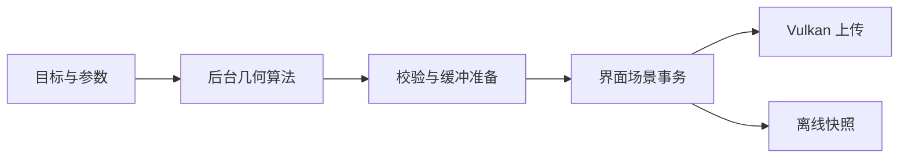

# 几何工具

右侧“几何”页对当前选中物体执行 Loop 细分、高度位移或 QEM 简化，并提供后台导出与取消。参数在点击“生成网格”时固定，修改参数会更新面数和内存估计。

## 使用方法

1. 在左侧选择物体，打开右侧“几何”页。
2. 设置 Loop 层数。0 层保留当前几何，适合对已有细网格直接执行位移。
3. 需要位移时启用“高度位移”，导入或选择线性高度图，设置幅度和中值。
4. 点击“生成网格”。阶段名称、处理数量和进度显示在面板与状态栏中。
5. 完成后查看模型、法线、深度和阴影。可撤销、重做，或导出 OBJ。

简化时将“操作”切换为“QEM 网格简化”，设置目标面数及边界/属性保护选项。结果显示请求与实际面数、停止原因、QEM 代价和独立双向表面距离。算法、参数和 LOD 示例见 [网格简化](SIMPLIFICATION.md)。

生成以当前网格为输入。再次生成会继续细分当前结果，恢复前一次几何可使用撤销。共享原网格的其他物体保留原状，选中物体获得新的网格资产。

## 参数

| 参数 | 含义与默认值 |
| --- | --- |
| Loop 层数 | 0–8，默认 2；每层将三角形数乘以 4 |
| 面数上限 | 默认及界面上限为 200 万 |
| 线性高度图 | 读取 R 通道，导入时按线性数据解码 |
| 位移幅度 | 默认 0.1，单位为物体局部米，允许负值 |
| 高度中值 | 默认 0.5，该高度对应零位移 |
| 接缝容差 | 默认 $10^{-6}$ 局部米，控制共享位置与边两侧允许的位移差 |

位移公式和接缝算法见 [高度位移](DISPLACEMENT.md)。导入高度图会添加线性纹理资产，并在几何页选中它。底色与环境图保持原有设置。

面板按网格规模估计工作内存，预算为 2 GiB。面数或内存超过预算时，生成按钮停用并显示调整提示。估计使用顶点/三角形数组长度，参数编辑会立即返回。

## 后台任务

`GeometryController` 管理几何处理、高度图导入、OBJ 导出和场景保存。任务使用固定输入，工作线程计算 CPU 数据，完成回调在界面线程执行。每次运行都创建新的取消标记和进度对象。

进度按当前阶段显示。顶点、边、面角、文件记录和字节分别使用各自的计数，拓扑校验和图像解码显示阶段忙碌状态。点击取消后，界面显示正在取消，工作线程在检查点结束任务。

窗口关闭时取消正在运行的几何任务并收回线程。文件提交成功的任务显示写出完成，任务控制器会保留这个提交结果。

## 场景事务

启动时记录目标物体、来源网格和场景版本。完成时核对这些来源，再通过一次 `SceneEditor` 事务创建新资产并修改目标物体引用。计算期间进行的材质、灯光或变换编辑会保留。目标被删除、网格被替换或场景被切换后，旧结果按取消或未应用状态结束。

工作线程将新网格的完整校验结果一起返回。`MeshValidationCache` 按共享所有权合并已验证记录，界面事务继续检查场景参数和资源引用。旧场景快照持有原网格，已有离线任务继续使用启动时的几何；界面将其结果标为过期。再次开始离线渲染会使用新网格。



顶点展开、线框索引和局部边界在后台准备，界面线程向 GPU 上传连续数据。准备数据按来源网格所有权缓存，保留当前场景和最近两份未使用结果，支持撤销与重做时复用。文件导入也使用相同的校验和准备流程。

## 文件任务

“导出 OBJ”写出当前选中物体的局部网格。输入资产路径受写入保护。工具栏“保存”和“另存”在后台保存启动时的场景快照，生成网格自动写入场景旁的资产目录。

保存期间可以继续编辑场景。若当前文档在保存期间改变，窗口标题带 `*`，状态栏提示还有未保存修改。再次保存可写入这些修改。文件格式、内容复用和提交过程见 [资产导出](ASSET_EXPORT.md)。

## 代码位置

- `geometry_panel`：参数、规模估计、任务状态与结果统计。
- `geometry_controller`：固定输入、工作线程、进度和取消生命周期。
- `Workbench`：选中物体、资产事务、撤销历史和文件操作。
- `geometry/loop`、`geometry/displacement`、`geometry/normals`：细分、位移和法线。
- `geometry/simplify`、`geometry/surface`：QEM 边折叠、最近点与表面误差。
- `render/raster_mesh`：实时顶点/索引准备、边界与 CPU 数据缓存。
- `assets/obj_writer`、`assets/asset_writer`、`assets/staged_file`：文件写出与提交。
- `geometry_smoke`：实际控件、后台任务、CPU/GPU 数据、历史和文件回归。

## 验证

```sh
cmake --build --preset macos-desktop-debug
python3 scripts/verify_gpu.py \
  build/macos-desktop-debug/src/app/desktop/minirender_desktop.app \
  --scene scenes/studio.json --geometry-check \
  --output outputs/a4.3/debug --sync-validation --timeout 400
```

响应时间在普通运行模式下单独测量：

```sh
python3 scripts/verify_gpu.py \
  build/macos-desktop-debug/src/app/desktop/minirender_desktop.app \
  --scene scenes/studio.json --geometry-check --timing-only \
  --output outputs/a4.3/timing --timeout 300
```

计时探针从独立线程投递界面事件，记录实际排队时延，并保留定时器间隔作诊断。计时排除图像读回和 CPU 参考计算的耗时，Vulkan 完整同步验证独立运行。基础几何结果见 [A4.2b 验收](checkpoints/A4.2b.md)，简化及扩展回归见 [A4.3 验收](checkpoints/A4.3.md)。
