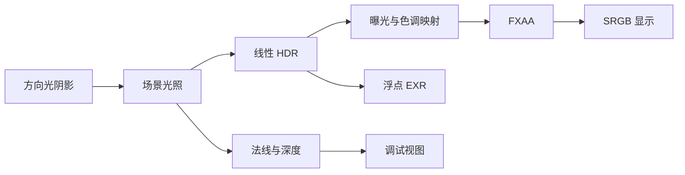

# HDR 与显示

## 数据流程



SceneRenderer 先把线性光照写入 RGBA32F 附件，同时输出 RGBA16F 世界法线和 D32 深度。PostProcess 再绘制全屏三角形，把这些附件转换为显示图像。修改曝光或显示模式不会改变原始 HDR 数据。

HdrTargets 管理附件、framebuffer 和 render pass；尺寸跟随交换链重建。GpuImage、GpuBuffer、GpuShader 分别负责图像、缓冲和 shader module 的资源所有权。resize 和释放顺序由 VulkanViewport 的 fence/设备等待约定保护。

## 显示变换

当前采用逐通道 Reinhard 映射，先乘曝光系数，再将每个通道映射到显示范围：

\[
x = \max(L,0)\,2^{EV}, \qquad y=\frac{x}{1+x}.
\]

这是用于工作台的简单逐通道算子，不包含自动曝光、白点或完整颜色管理。显示过程中可以截断负值，EXR 导出保留原始有限浮点值。

FXAA 接收色调映射后的感知颜色值。shader 将各 HDR texel 映射并编码为 sRGB，再显式做双线性插值；这也避免依赖 float32 纹理的可选硬件线性过滤能力。过滤结束后先解码回线性值，由 SRGB swapchain 执行最终编码，避免重复 gamma。

FXAA 包括局部对比度检测、水平/垂直边缘分类、双向端点搜索和亚像素混合。当前固定搜索上限为 16 步。它改善单帧空间锯齿，不提供 TAA 或运动历史。

## 调试视图

法线附件保存带符号的世界法线，显示时归一化并映射到 [0,1]。深度附件保存 Vulkan 非线性深度，显示前按相机 near/far 恢复视空间距离：

\[
z=\frac{nf}{f-d(f-n)}.
\]

深度视图使用灰度 \(1/(1+z)\)，便于观察近处几何层次；背景显示为黑色。两种调试视图都绕过曝光和 FXAA。

## EXR 输出

工具栏“导出 EXR”触发一帧 HDR 回读。命令缓冲把 HDR 图像转为 transfer source、复制到 host coherent buffer，再恢复 shader-read 布局。等待本帧 fence 后才读取 CPU 数据。

Image::write_exr 使用 TinyEXR 1.0.12 的内存接口，写出 ZIP 压缩、32 位浮点 B/G/R 通道。文件路径由 filesystem 处理，支持中文及空格。导出不应用曝光、色调映射、FXAA 或 sRGB 编码。read_exr 返回原始 RGB 数值，不执行外部文件工作色域转换。

TinyEXR/miniz 以固定 URL 与 SHA256 获取三个必要源码文件，保留上游许可证。codec 独立为 CPU 静态库，不依赖 Qt、Vulkan、CUDA；C 语言仅用于其压缩依赖。大量上游测试图像不作为工程依赖下载。

## 验证

```sh
python3 scripts/verify_gpu.py build/macos-desktop-debug/src/app/desktop/minirender_desktop.app --scene scenes/studio-two-lights.json --output outputs/a1.4 --timeout 60
```

端到端测试将一个物体设置为已知自发光值 (8,2,0.5)，关闭其他光照，再检查 GPU HDR、EXR 往返和显示编码。曝光增加两档后，整幅原始 HDR 的最大差异必须为零，但显示图像应变亮。

FXAA 开关检查高对比度边缘的变化，并确认选定平坦内部像素保持不变。调试视图把可见地面点投影到屏幕，与 CPU 法线和视空间深度比较。最后改变窗口尺寸，再检查 HDR 回读大小和资源释放。

原始结果包括 radiance.exr、hdr-tonemapped.png、exposure-plus-two.png、fxaa-on.png、depth.png 和 resized-depth.png。可用 OpenEXR 的 exrheader 独立检查文件通道类型与数据窗口。

## 阅读顺序

1. HdrTargets：附件布局、render pass 依赖和可选回读。
2. SceneRenderer：阴影、场景、后处理三个阶段的调用顺序。
3. PostProcess 和 post.frag：显示变换、FXAA、法线/深度视图。
4. core/exr_io.cpp：像素通道排列、第三方缓冲的 RAII 和文件读写。
5. scene_smoke.cpp：数值、图像和 UI 更新链路的组合验证。

FXAA 参考 [Timothy Lottes 的 NVIDIA 原始白皮书](https://developer.download.nvidia.com/assets/gamedev/files/sdk/11/FXAA_WhitePaper.pdf)，实现使用固定参数并保留独立注释。EXR 接口参考 [TinyEXR v1.0.12](https://github.com/syoyo/tinyexr/tree/v1.0.12)。
