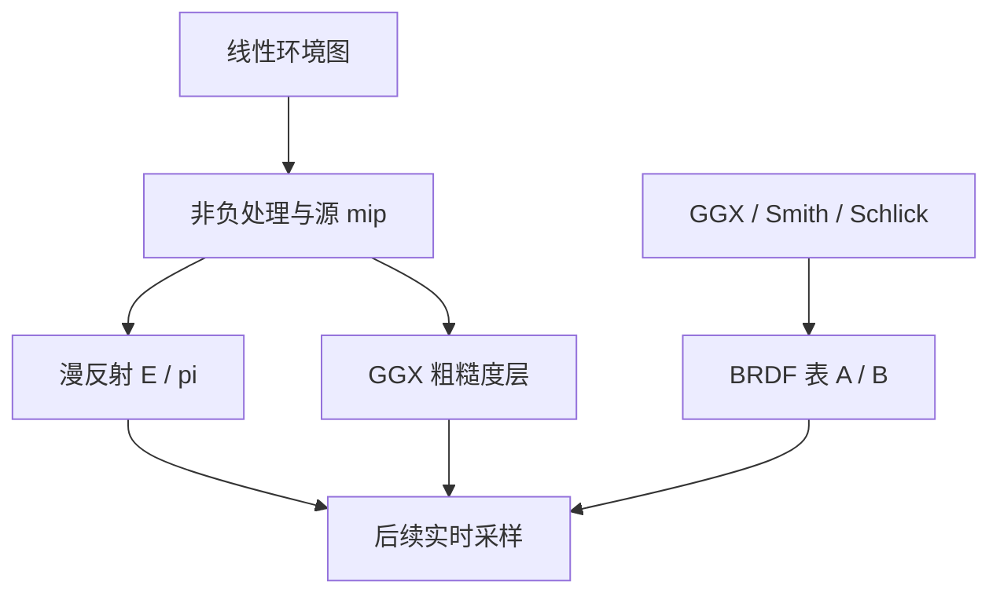

# IBL

## 职责

A3.2a 提供独立于 Qt/Vulkan 的 CPU 预处理核心，生成环境漫反射、不同粗糙度的镜面环境和 BRDF 查找表。A3.2b 通过后台控制器和 Vulkan 浮点纹理接入实时管线，使用见[环境界面](ENVIRONMENT_UI.md)。

输入 `Texture` 已是线性 RGB。预处理不包含常量 `environment`、环境图强度和旋转，因此这些参数变化可以复用同一结果。完成后返回 `shared_ptr<const>`，数据可以跨线程只读共享。



## 坐标

经度零为 +X，北极为 +Y，经度增加朝 +Z。世界方向到源图的映射与 `EnvironmentLight` 一致：

$$u=\operatorname{fract}\left(\frac{\operatorname{atan2}(d_z,d_x)+\theta}{2\pi}\right),\qquad
v=\frac{\operatorname{atan2}(\sqrt{d_x^2+d_z^2},d_y)}{\pi}.$$

$\theta$ 是右手系绕 +Y 的旋转。API 接收角度，内部先对 360° 取余。X 重复寻址，Y 夹取；双线性和层间插值都在线性空间执行。

源图使用普通纹素中心，像素坐标为 $(uW-0.5,vH-0.5)$。低分辨率烘焙图另外包含南北极端点，像素坐标为 $(uW-0.5,v(H-1))$。极点只计算一个方向并复制整行，避免不同经度的采样误差产生接缝。两个布局不能混用。

## 源图处理

负辐射在生成 mip 前截为 0。若先平均正负像素，原图中的有效照明可能被抵消。已有非负纹理可直接复用 mip；过大的源图选取满足尺寸上限的级别，只保留有界的预处理源。

`Texture` 构造新增可选的取消标记，有限值检查和 mip 生成均逐行检查取消。旧调用不传 token，行为保持一致。

## 漫反射

数据存储 $E(n)/\pi$：

$$D(n)=\int_{\Omega^+}L_i(l)\frac{\max(n\cdot l,0)}{\pi}\,d\omega.$$

使用余弦半球采样后，PDF 与积分中的余弦/π 抵消，结果为环境辐射样本的均值。Lambert 材质直接乘底色，不再乘一次 π。常量环境 $L_i=C$ 的结果应为 $D=C$。

输出为 2:1 latlong，默认 32×16。法线框架复用已有 `ShadingFrame`，方向采样复用 `sample_cosine_hemisphere`。

## 镜面环境

预滤波采用 $N=V=R$ 的近似。对 GGX 法线采样，反射得到方向 $L$，按 $\max(N\cdot L,0)$ 加权平均环境辐射。第 0 层直接按输出角度网格重采样源图，尖锐细节受输出分辨率限制。

粗糙度按 $r_i=i/(K-1)$ 分层，$\alpha=r^2$。所有层保留相同的角度分辨率，默认 6 层、每层 128×64。高粗糙度仍具有方向性，1×1 latlong 无法表达这种变化，因此这里使用粗糙度层，不将其当作普通 mip 链。

采样使用经过固定平移的 Hammersley 序列。对 $N=V$，GGX 反射方向的 PDF 为 $D(H)/4$。Filtered Importance Sampling 按样本立体角选择源图 LOD：

$$\omega_s=\frac{1}{N_s p(L)},\qquad
\lambda=\frac12\log_2\frac{\omega_s}{\omega_{texel}}.$$

源纹素立体角按所在 latlong 行精确计算：

$$\omega_{texel}=\frac{2\pi}{W}(\cos\theta_0-\cos\theta_1).$$

LOD 夹在有效 mip 范围内。源 mip 仍使用平面图像的面积平均，球面映射与有限采样会带来过滤近似。

## BRDF 表

镜面结果采用 split-sum 形式：

$$L_s\approx L_p(R,r)\,[F_0A(N\cdot V,r)+B(N\cdot V,r)].$$

本项目使用 GGX、Smith G1 乘积和 Schlick Fresnel，与 CPU 导体 BSDF 相同。它不采用 UE4 对解析光源的粗糙度重映射或 Schlick 几何项近似。

令 $F_c=(1-V\cdot H)^5$。用白色 $F_0=1$ 的 BSDF 进行已有 VNDF 采样，其吞吐权重为 $W=f_{white}\cos\theta/p$，于是

$$A=\mathbb E[W(1-F_c)],\qquad B=\mathbb E[WF_c].$$

无效的下半球反射保留为零贡献，不重新抽样或重新归一化。光滑极限使用 $A=1-(1-N\cdot V)^5$、$B=(1-N\cdot V)^5$；连续模型在 $N\cdot V=0$ 节点以 $10^{-6}$ 的正余弦近似掠射极限。

默认表为 64×64，RGB 存 `(A,B,0)`。x、y 对应参数区间的端点，查询坐标为 $(N\cdot V(W-1),r(H-1))$。它是数据表，不能应用颜色解码或 Reinhard。

## 进度与取消

`bake_ibl_environment` 和 `bake_ibl_brdf` 是同步函数，调用方应将其放到后台线程。回调也在该线程执行，不直接访问 Qt。`source/diffuse/specular/brdf` 报告本阶段已完成的像素数；`mipmaps` 的 total 为 0，供上层显示忙碌状态。

采样循环每 64 个样本、图像处理每行检查取消。取消抛出 `OperationCancelled`，未完成数据不发布。回调异常向调用方传播。固定种子和参数在同一平台上逐像素可复现，跨平台使用数值容差比较。

默认尺寸和样本数可在 `IblEnvironmentSettings`、`IblBrdfSettings` 调整。环境采样预算上限为 512M，BRDF 表为 128M，超出时在分配输出前拒绝。镜面预滤波至少使用 2 个样本，避免权重和为零。

## 验证

```sh
cmake --build --preset macos-core-release
build/macos-core-release/minirender_tests '[ibl]'
ctest --preset macos-core-release
```

测试使用轴向/随机方向与路径光照核对映射，用常量 HDR 环境检查归一化；对 $L(d)=1+0.5d$，漫反射和完全粗糙预滤波的解析结果为 $1+n/3$。还检查小亮光源扩散、球面能量、极点、旋转、固定种子、负值处理及各阶段取消。

BRDF 对照采用独立的 256×256 半球立体角积分。$F_0=1,r=1,N=V$ 的解析反照率为 $1-\ln2$，用来检查采样中的零贡献事件和归一化。

## 阅读

1. `ibl.hpp`：数据布局、参数和线程边界。
2. `coordinates/bilinear/baked_latlong`：源图与烘焙图的坐标区别。
3. `prepare_source`：非负处理、有界分辨率和取消。
4. `bake_ibl_environment`：Lambert 均值、GGX 方向及源图 LOD。
5. `integrate_ibl_brdf`：利用白色 BSDF 分离 A/B。
6. `ibl_tests.cpp`：解析、独立积分和阶段取消验证。

实时部分继续读 `IblController` 的来源切换与结果发布、`GpuIbl` 的上传/回收、`ibl_sampling.glsl` 的数据查询，最后读 `ibl_smoke.cpp` 的 CPU/GPU 对照。镜面层使用 2D array，环境背景在主场景 MRT 中绘制且不写深度；环境漫反射继续单独输出，供 SSAO 合成。

## 资料

[Karis，2013，Real Shading in Unreal Engine 4](https://cdn2.unrealengine.com/Resources/files/2013SiggraphPresentationsNotes-26915738.pdf) 给出 split-sum、GGX 环境预滤波和 BRDF 表。本项目使用 latlong 粗糙度层及极点端点布局，并复用自身的 Smith/VNDF BSDF。

[Colbert、Křivánek，GPU Gems 3 第 20 章](https://developer.nvidia.com/gpugems/gpugems3/part-iii-rendering/chapter-20-gpu-based-importance-sampling) 说明按 PDF 对应的立体角选择 mip 过滤范围；[Filtered Importance Sampling 原文](https://cgg.mff.cuni.cz/~jaroslav/papers/2008-egsr-fis/2008-egsr-fis-final-embedded.pdf) 提供该方法的论文来源。
