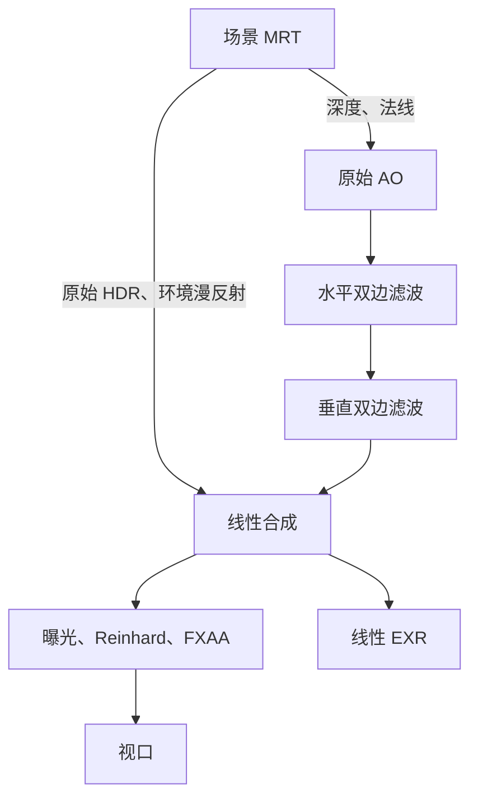

# SSAO

## 流程

SSAO 从当前帧的深度和法线估计附近的遮蔽。它补充实时预览中的接触细节，完整路径追踪继续计算自身的光照传输。



主场景单独记录环境漫反射，使 AO 的作用范围可以精确控制。各图像尺寸跟随交换链，均由所属 Vulkan pass 独占。

| 附件 | 格式 | 用途 |
| --- | --- | --- |
| 原始 HDR | RGBA32F | 自发光、直接光与环境光之和 |
| 环境漫反射 | RGBA32F | 供 AO 合成扣除被遮蔽的部分 |
| 法线 | RGBA16F | 世界空间单位法线，alpha 区分几何和背景 |
| 深度 | D32F | Vulkan 的 0..1 深度 |
| 原始、水平、最终 AO | R32F | 遮蔽采样及两个滤波方向 |
| 合成 HDR | RGBA32F | 显示和线性导出的共同输入 |

## 采样

像素原点在左上角。投影矩阵已经包含 Vulkan 的 Y 翻转，重建时直接反解同一个矩阵。对像素中心 $u,v$ 和深度 $d$，先求

$$h=P^{-1}(2u-1,2v-1,d,1)^T,\qquad p=h_{xyz}/h_w.$$

深度为 1 或法线 alpha 无效的背景返回 AO=1，邻域样本也要通过法线有效性检查。世界法线通过 view 矩阵的旋转部分转到相机空间。后续位置和半径均使用相机空间的米，避免在大世界坐标中相减。

CPU 用固定种子生成 64 个局部 +Z 余弦半球方向，并将长度分布设为 $0.1+0.9\xi^2$，让中心附近有更多采样点。每个前缀都包含完整半径范围，改变样本数不会同时缩小采样范围。shader 根据像素坐标生成一个固定旋转角，在法线的切平面中旋转采样核；它不随帧号变化。

采样位置为 $s_i=p+rTk_i$。将其投影到屏幕，读取该位置可见表面的相机空间坐标 $q_i$。相机朝向 -Z，较大的 Z 更靠近相机，因此遮挡判断为 $q_{i,z}\geq s_{i,z}+b$。仅保留附近表面的贡献：

$$w_i=1-\operatorname{smoothstep}(r/2,r,\|q_i-p\|),$$
$$A=\operatorname{clamp}\left(1-\frac{g}{N}\sum_i w_i\,[q_{i,z}\geq s_{i,z}+b],0,1\right).$$

$r$ 为半径，$b$ 为深度偏移，$g$ 为强度。屏幕外、相机后方、裁剪范围外和背景样本按开放方向处理，分母仍为总样本数 $N$。

## 滤波

原始 AO 使用水平、垂直两个一维双边 pass。每个方向读取 -4..4 共 9 个像素，以距离、相机空间深度和世界法线作为权重：

$$w_{pq}=\exp\left[-\frac12\left(\frac{\Delta x^2}{2^2}+\frac{\Delta z^2}{(r/4)^2}\right)\right]\max(n_p\cdot n_q,0)^{16}.$$

输出为 $\sum_qw_{pq}A_q/\sum_qw_{pq}$。背景直接返回 1，邻域中的背景样本不参与几何像素的平均。正交表面之间的法线权重为 0，减少轮廓和折角附近的遮蔽扩散。

两次一维处理是完整二维引导双边滤波的近似，使用相同的原始深度和法线作为引导信号。关闭“使用双边滤波”后，合成读取原始 AO；调试视图仍可检查两个阶段。

## 合成

设原始光照为 $C$、其中的环境漫反射为 $C_a$，合成为

$$C'=\max\bigl(C-C_a(1-A),0\bigr).$$

直接光、自发光和环境镜面反射不乘 AO。这个步骤发生在曝光和色调映射之前。实时 EXR 导出读取 $C'$，与视口使用同一个线性结果；法线、深度、线框和 AO 调试视图只改变显示。

原始和滤波 AO 直接显示为灰度，忽略曝光、Reinhard 和 FXAA。shader 先解码该灰度，再交给 sRGB 交换链编码，保证截图中的 0..255 可以直接对应 AO 值。

## 参数

右侧“实时”页提供开关、滤波、半径、偏移、强度和样本数。默认半径 0.5m、偏移 0.02m、强度 1、32 个样本；默认关闭，便于与原始光照对照。“相机”页的显示列表可选择原始 AO 和滤波 AO。

这些是当前视口的显示参数，不写入场景文件，也不使离线任务的固定快照过期。离线显示期间，实时参数面板停用。修改 AO 参数只写入帧 UBO，不重新上传网格、重建材质描述符或交换链。

关闭 SSAO 时，首次建立白色 AO 图像和有效布局；此后跳过采样与滤波，只复制线性合成结果。重新启用后按当前深度和相机计算。

## 同步

`ScreenPass` 管理单个颜色输出、描述符、管线和 framebuffer。每个 pass 以 shader-read 布局结束，通过颜色写入到片元读取的依赖连接。采样器使用最近邻，不依赖 float32 线性过滤能力。

线框复用只读深度附件，其 STORE 操作仍须计入深度写访问范围。后续 AO 及调试采样等待该访问；相关语义见 [Vulkan STORE 说明](https://docs.vulkan.org/refpages/latest/refpages/source/VkAttachmentStoreOp.html)。所有资源回收和帧 UBO 更新继续遵循视口的一帧 fence 协议。

## 边界

SSAO 只能读取本帧可见表面，无法恢复屏幕外、被遮挡或透明物体后的几何。边缘的开放方向、局部距离衰减和深度偏移都会影响亮度。相机移动时，固定在屏幕上的随机旋转会改变表面接受的样本，本阶段未加入时域累计。

CPU 几何遮挡参考使用半径内的真实遮挡射线。它与 SSAO 的可见性信息和距离权重不同，验证比较接触与开放区域的顺序，不要求数值相等。

## 验证

```sh
cmake --build --preset macos-desktop-debug
ctest --preset macos-desktop-debug
python3 scripts/verify_gpu.py build/macos-desktop-debug/src/app/desktop/minirender_desktop.app --scene scenes/studio.json --ssao-check --sync-validation --output outputs/ssao --timeout 65
```

回归使用无直接光的灰色场景，逐像素对照 AO 和线性 HDR 合成，检查背景、接触区域与开放平面。它还检查滤波后的相邻像素差、直接光/自发光/金属环境反射隔离、线框 HDR、资源复用、相机变化、缩放和启用 AO 时的 Qt 拖拽。

Qt/Cocoa 可能分多次更新布局和原生 surface。回归等待真实像素尺寸稳定后采集基准，并校验相机与图像尺寸，避免将不同输入的图像作逐像素对照。

## 阅读

1. `render/ssao.hpp`、`ssao.cpp`：参数单位、范围与固定采样核。
2. `scene.frag`、`HdrTargets`：环境漫反射的独立输出。
3. `ssao.frag`：位置重建、切线旋转、投影比较和距离衰减。
4. `ao_filter.frag`：两个方向的引导双边滤波。
5. `ao_composite.frag`：线性光照合成。
6. `ScreenPass`、`SsaoPass`：Vulkan 资源所有权及阶段连接。
7. `ssao_smoke.cpp`：几何参考、图像对照和交互验证。

## 资料

[Mittring，2007，Finding Next Gen – CryEngine 2](https://www.advances.realtimerendering.com/s2007/Mittring-Finding_NextGen_CryEngine2%28Siggraph07%20Course%20Notes%29.pdf) §8.5.4.3 介绍基于深度比较和随机化的 SSAO，并说明将其用于环境光。本项目采用法线余弦半球及切线旋转，原文使用球核和随机反射平面，两者的采样方式不同。

[Tomasi、Manduchi，1998，Bilateral Filtering for Gray and Color Images](https://users.soe.ucsc.edu/~manduchi/Papers/ICCV98.pdf) 给出距离与相似性共同加权的双边滤波。本项目用深度和法线引导 AO，并用两个一维 pass 近似处理。
